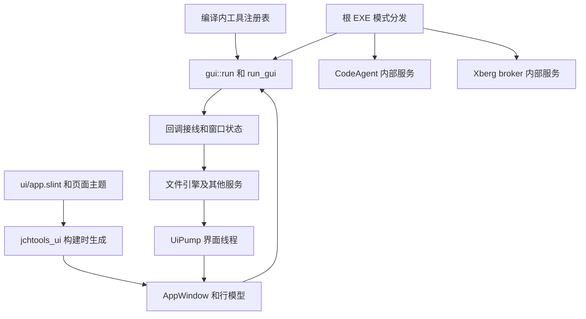
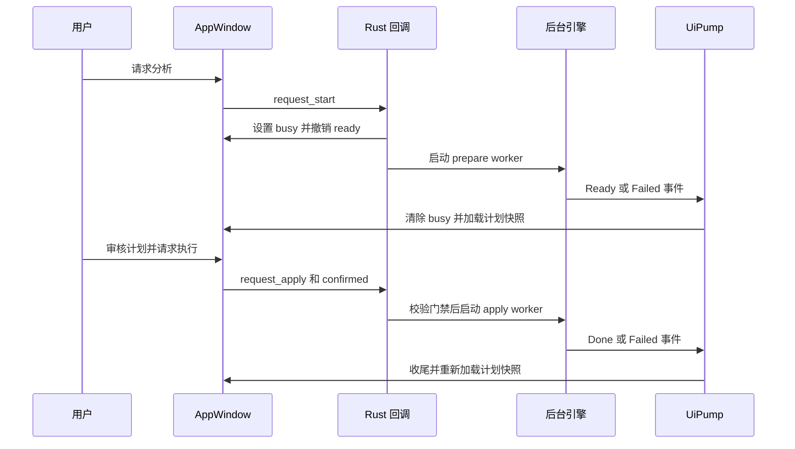

# 应用装配、GUI 状态与后台任务

## 入口和装配边界

根 [main.rs](../../src/main.rs) 是模式分发薄壳，而不是界面或业务实现。默认调用 `jchtools_gui::gui::run()`；启动失败时显示错误对话框并退出，提示可尝试 `SLINT_BACKEND=winit-software`。首个参数为 `--codeagent-service` 时运行 CodeAgent 服务，第二个参数 `--stop` 改为停止服务；`--xberg-broker` 运行共享代理服务。这些内部模式共用 `run_background`：初始化诊断日志、服务失败时记录 `application_failed`，刷盘后以 1 退出，unwind 路径也有刷盘兜底。共享代理的运行方式另见[共享 Xberg](../integrations/shared-xberg.md)。

图：根入口选择运行模式，GUI 装配层连接生成界面、注册表和业务组件。

[ui/app.slint](../../ui/app.slint) 导入页面、`theme.slint`、控件及模型，导出 `AppWindow`、行类型、属性和回调；[crates/ui/build.rs](../../crates/ui/build.rs) 在 `gui` feature 下以 fluent 样式编译它，并监听整个 `ui/` 和图标变化，`mcp-debug-info` 可增加元素调试信息。[crates/ui/src/lib.rs](../../crates/ui/src/lib.rs) 只包含生成的模块；业务接线在 [gui.rs](../../crates/gui/src/gui.rs) 及其子模块。`run_gui` 创建窗口、`State` 和事件通道，装配各工具回调后才调用 `select_tool`，再安装事件泵、显示窗口并进入事件循环。默认选递归解压；`--snap-ocr-settings` 选截图 OCR，`--settings` 打开设置页。规则规格从资源加载，默认规则配置是会话内状态。

## 注册、导航与状态所有权

[registry::tools](../../crates/gui/src/registry.rs) 是编译内真实工具描述符列表，不是动态插件执行器。列表提供唯一 ID、名称、类别和摘要；搜索按名称及摘要过滤。新增工具不能只加一行注册：还要让 `Tool::from_id`、`sections`、`apply_tool_switch` 的 screen 映射、Slint 页面与相应回调一致，并检查启动默认项和测试。非工具的关于及设置页通过 `navigation` 切换并清除侧栏活动工具高亮。

`apply_tool_switch` 恢复完整工具列表、更新 `screen` 和 `active-tool-id`，清除页面提示，并重置规则分区、面板及 MD 子页。空闲时切换工具会清除旧工具的共享日志和指标；忙碌时保留运行上下文，转换任务切回时也保留进度。进入转换、截图或 CodeAgent 页面分别触发组件检查或后台连接。切工具后重新计算目录/计划就绪性，而非无条件销毁计划；运行中的状态文字不能被导航的就绪检查冒充为已结束。具体行为见 [wiring.rs](../../crates/gui/src/gui/wiring.rs) 和[导航测试](../../crates/gui/src/gui/tests_tools_navigation.rs)。

`State` 由界面线程上的 `Rc<RefCell<_>>` 持有，包含配置、任务路径、控制器、运行口径、日志、确认相关挂起操作及各类请求代际；Slint 属性则承担可见状态和交互门禁。`busy` 表示共享任务运行，`ready` 表示当前计划可执行，`plan-editable` 则按任务库状态控制勾选，并不等同于暂时可能因保存而降低的 `ready`。目录编辑立即撤销 `ready` 和解压确认，旧计划的就绪检查去抖后异步重算；无计划目录检查由单 worker 合并请求，避免在界面线程做磁盘探测。非法数字草稿保留供修正，不能悄悄用旧配置执行。

## 从回调到终态

下面以目录整理为例；分析与执行是两个阶段，只有执行需要破坏性确认。文件层面的约束另见[文件任务安全](../concepts/file-task-safety.md)和[目录整理工作流](../workflows/directory-organization.md)。

图：整理分析和确认执行分别由后台 worker 生成终态，界面线程消费事件并重新取得计划真值。

`start_task` 在启动前检查 `busy`、勾选保存和依赖重算、失败标记、页面是否已呈现、`ready` 与配置；执行还要求已有任务。`begin_task_run` 创建 `Control`，先设置 `busy`、清理暂停与错误，再把磁盘工作交给线程。`prepare` 返回 `Event::Ready`，`apply` 返回 `Event::Done`；引擎通过 `Context` 接收控制器和事件通道。终态先清运行态并保持 `ready=false`、计划不可编辑，再异步加载任务库的计划页和快照，避免用旧状态放行。勾选由串行 writer 落库，在途期间撤销执行权；失败或依赖重算失败不能继续使用旧计划。

解压路径不同：`request_extract_start` 校验后先显示确认框，以 `confirm-pending` 禁止清点未完成时确认，后台清点成功后更新文案；确认后 `start_extract` 一段式运行，以 `ExtractDone` 收尾，不把解压结果当作整理计划。清点错误和 panic 都回传带代际的错误；整理及解压 worker 的 `spawn_event_worker` 把引擎错误和 panic 转成 `Event::Failed`，界面关闭导致投递失败则记录警告。`Failed` 清除忙碌状态，区分用户取消和真实错误，先 fail-closed 再重载计划及相关失败列表；已完成操作不会自动回滚。

## 事件泵、过期结果与停止

worker 不直接访问非 `Send` 的窗口或 `State`。`EventSender` 发送结果后通过 `slint::invoke_from_event_loop` 唤醒界面线程的排空钩子；通道满时 worker 背压，而界面线程的发送转交后台以免卡住界面。引擎的裸通道事件仍由轮询处理。`UiPump` 同时有 100ms 定时器作为进度、耗时、主题及排空兜底；每轮主通道最多处理 256 条，日志可见时合批刷新，终态立即呈现。事件循环退出后移除线程局部钩子，避免保留旧窗口状态。

异步结果必须与当前意图匹配：计划页和就绪快照各有独立 `PlanLoadSync` 代际，结果还与任务、筛选和目录上下文核对；解压清点、失败列表、截图资产检查、转换预检与设置快照也有各自的代际或任务身份。旧事件不能解除新确认的门禁或覆盖新页面。修改请求路径时，应在发起、作废及消费三处一起维护这些检查，而不只是屏蔽显示。

取消调用 `State::cancel_all_running`，分别通知任务控制器、转换、转换组件初始化和截图初始化；它是协作式停止，在安全边界结束当前操作。Git 和 Markdown 转换不支持暂停，界面如实提示。活动期间关窗先显示 `confirm-kind=3`；确认后请求所有可取消阶段停止，`close_after` 等待活动结束再退出。空闲关窗也显式退出事件循环，而不是只隐藏窗口。已启动的截图 OCR 独立服务不因关闭 GUI 而停止，详见[截图与 CLI OCR](../workflows/screenshot-and-cli-ocr.md)。

## 修改与验证

- 改页面时同时检查 Slint 属性、回调和 Rust 接线；特别验证切页期间的 `busy`、确认框、就绪与日志，不能让导航抹掉运行结果。
- [tests_tools_navigation.rs](../../crates/gui/src/gui/tests_tools_navigation.rs) 覆盖路由、分区、高级规则及忙碌时切换文案；`registry` 测试检查 ID 唯一和字段非空。计划页、转换、解压失败等对应测试覆盖各自的异步门禁。
- [gui_tests.rs](../../crates/gui/src/gui/gui_tests.rs) 使用专用线程串行装配并重置无头 Slint 测试界面，可通过 `invoke_*` 和手动 pump 断言回调状态；这不等于真实窗口、系统后端、鼠标或绘制验证。真实窗口及更广泛的验证方式见[验证指南](../testing/verification.md)。
