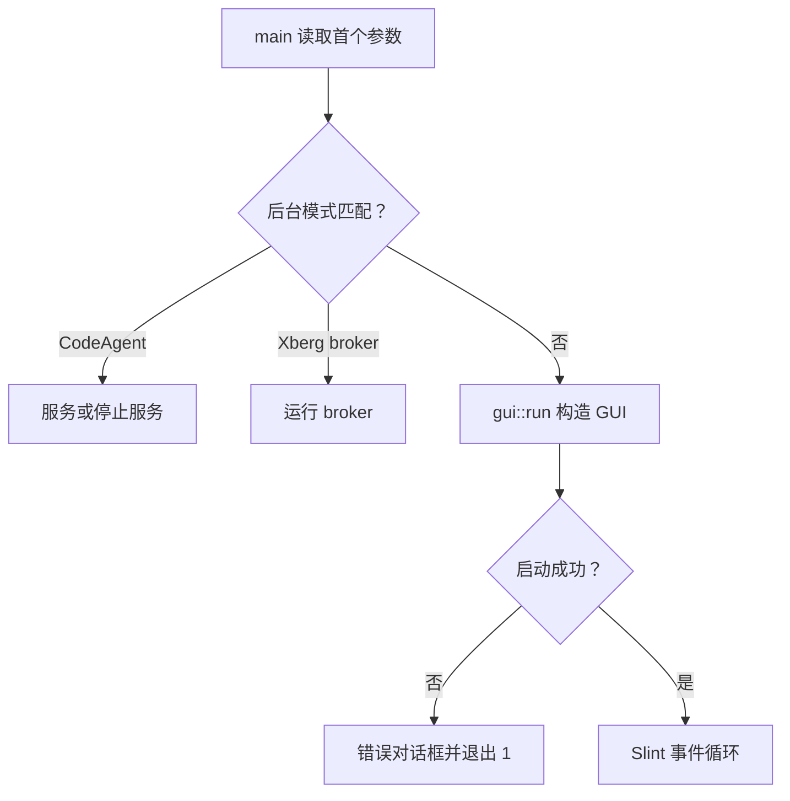
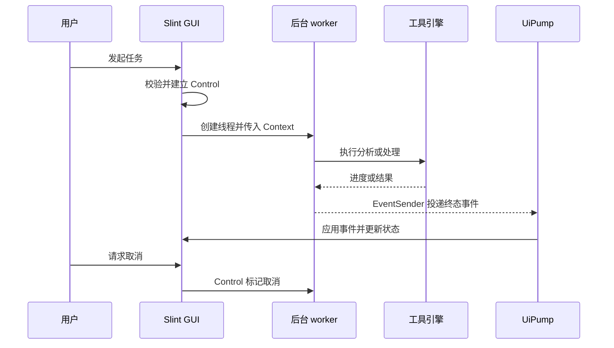

# 应用架构与 GUI 任务编排

## 入口模式与责任边界

`src/main.rs` 是薄入口：首个参数为 `--codeagent-service` 时进入 CodeAgent 服务，后续参数 `--stop` 选择停止分支；`--xberg-broker` 启动 Xberg broker。两个服务分支共享日志初始化、失败事件记录和退出前刷盘骨架。未命中时调用 `jchtools_gui::gui::run()`；GUI 初始化失败会显示错误对话框并以 1 退出，提示可尝试 `SLINT_BACKEND=winit-software`。Windows 非测试构建采用 GUI 子系统，测试构建保留控制台子系统以便测试驱动收集输出。

图 1：进程入口根据首参数分派后台服务或桌面 GUI。

## GUI、Slint 与工具域

GUI 业务组装集中于 `crates/gui/src/gui.rs`，而非 `main`。`crates/ui/src/lib.rs` 通过 `slint::include_modules!()` 引入生成的 Slint 接口；GUI 层持有 `AppWindow`，将 Slint 回调接到状态和引擎。`wire_sync` 绑定导航、规则输入、选择等同步交互；`wire_task_lifecycle` 绑定任务启动、暂停/继续、取消、关闭等生命周期操作。工具切换由 `Tool::from_id` 将注册 ID 映射到内部工具类型并设置屏幕及工具特定状态。

`registry::tools()` 是静态编译内置工具目录，不是动态插件加载器，也不执行任意扩展代码。目录整理、递归解压分别连接 `jchtools_directory_organizer::engine` 与 `jchtools_recursive_extract::engine`；其他集成域包括 Markdown/Git、转换、截图 OCR 与 CodeAgent。新增工具需同时具备实际视图/引擎，并接入注册表、工具 ID 映射、导航和对应回调/状态处理；仅添加注册项不会形成可执行插件。

## 工作线程、事件投递与界面泵

耗时文件系统及引擎工作不应阻塞 Slint 回调。以目录整理和递归解压为例，启动侧校验忙碌态、规则草稿及计划状态，创建 `Control` 并将其保存在 GUI `State`，设置忙碌 UI 后启动线程。线程通过 `Context` 获得控制句柄和引擎事件通道，执行后将 `Ready`、`Done`、`ExtractDone` 或 `Failed` 等结果经 `EventSender` 交回 GUI。`spawn_event_worker` 将引擎错误转成失败事件，捕获 panic 并生成固定错误文案；若 UI 已退出导致发送失败，则记录投递失败并放弃结果。

图 2：GUI 线程负责校验和呈现，worker 执行引擎工作，事件泵将结果应用回 Slint 状态。

`UiPump` 负责排空核心事件、失败列表消息、OCR 消息及 CodeAgent 消息，并更新日志、失败列表和实时指标。周期性 100ms 刷新是进度/耗时及唤醒不可用时的兜底；worker 结果发送还会唤醒事件循环，使终态不必等待完整轮询周期。系统主题每 2 秒轮询；日志面板整段重建受 500ms 最小间隔约束，终态日志立即呈现。不同消息通道承载不同子域消息，泵在 UI 线程统一检查并应用。

## 状态、任务阶段与取消

`State` 由 GUI 侧以 `Rc<RefCell<State>>` 管理，保存当前工具、目录、配置、活动 `Control`、任务时间、运行模式、计划状态及日志等；跨线程控制通过 `Arc<Control>` 共享，而不是让 worker 直接修改 Slint 属性。`begin_task_run` 建立新的控制对象、清理本次任务日志与关闭标记、重置起算时间并切换 busy 状态。取消由 `Control` 协调引擎；线程完成后仍以事件驱动 UI 收尾。关闭请求可以等待活动操作结束，关闭标记在新任务启动时清除，避免前一任务的关闭意图泄漏到下一次运行。

目录整理采用“分析后审核，再执行”的两阶段流程：分析返回可供用户检查的计划，确认执行前会阻止仍在进行的勾选/依赖重算、失败的重算或尚未呈现的新计划；执行阶段复用同一任务库。递归解压则是确认后单阶段运行，不经过整理计划审核，其终态只收尾解压摘要。解压清点也在后台执行，并用 generation 丢弃过期结果；目录编辑或新请求会推进代际，防止迟到消息污染当前确认框。计划页、失败列表及 OCR 等异步结果同样使用代际或任务身份检查，避免旧请求覆盖新状态。

这些边界意味着：UI 忙碌状态及校验必须先于耗时 I/O；worker 不应持有 Slint 组件直接更新属性；错误和 panic 应通过事件回到 UI；UI 已关闭时投递失败是可预期的结束边界。修改任务编排时，应同时检查取消控制、代际过滤、终态事件应用和关闭收尾，而不能只调整线程启动代码。

## 配置、集成与测试

工具配置和服务生命周期由各领域模块负责，GUI 通过其公开引擎/API 连接；Xberg/OCR 服务细节见[集成页](../integrations/xberg-and-ocr.md)，设置与服务运维见[设置与服务](../operations/settings-and-services.md)。目录整理和解压的领域语义分别见[目录整理工作流](../workflows/directory-organizer.md)与[归档解压工作流](../workflows/archive-extraction.md)。

测试重点是装配与边界行为：`gui.rs` 的测试模块包含无头 GUI 装配及计划、工具导航、设置、转换、解压失败等专项测试；`registry.rs` 测试注册 ID 唯一且字段非空；`src/main.rs` 测试 Windows 测试骨架确为控制台子系统。适合回归验证的关键点是：错误/panic 能生成终态、取消后不继续未执行步骤、迟到代际事件被忽略、计划未就绪时不能确认执行，以及窗口关闭后结果投递失败不会造成 UI 线程访问。
