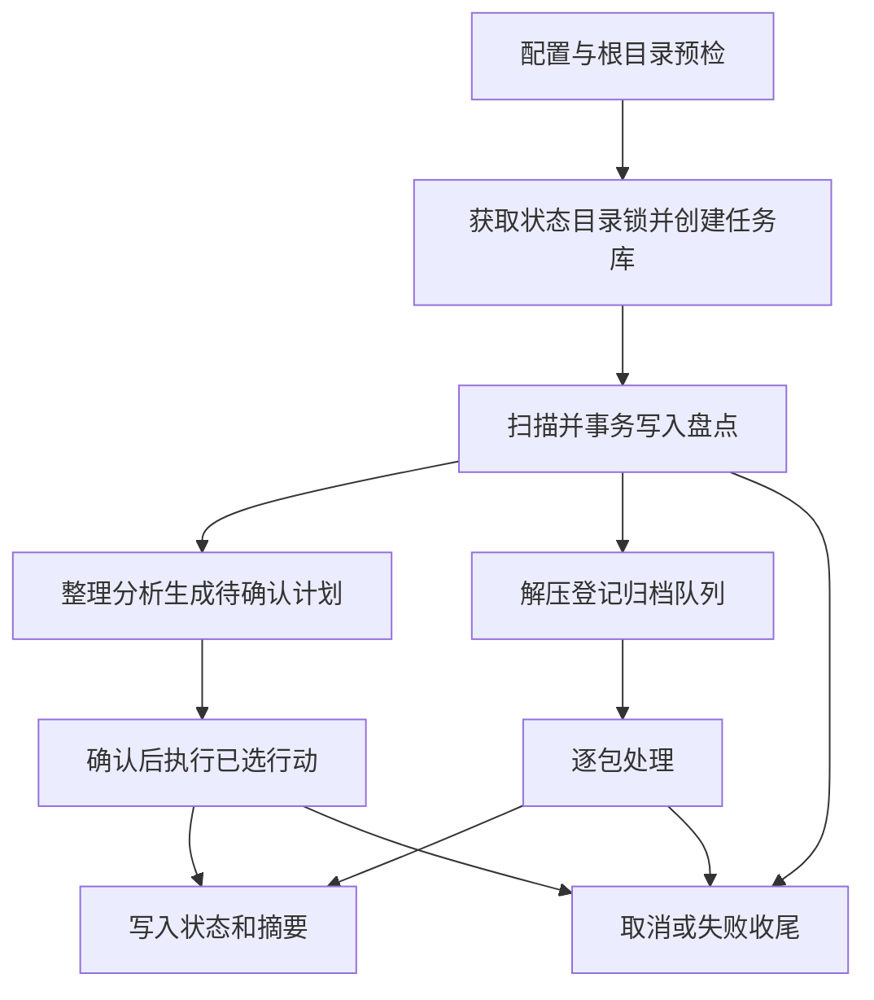

# 文件任务的安全边界与持久状态

递归解压与目录整理是独立工具，不自动串联（H-03）；但它们依赖 `file-core` 的共同入口和原语。修改扫描、路径或任务库时，应同时检查[递归解压](../workflows/recursive-extraction.md)和[目录整理](../workflows/directory-organization.md)的调用，不要把某一工具的删除授权扩展到另一工具。[应用合同](../../openspec/specs/application-contract/spec.md)是需求本体，下述实现和测试是对应证据，不等同于验收通过。

## 进入任务前的边界

**H-06 要求**：根或任何祖先直接含大小写不敏感的 `.git` 文件或目录时，两工具拒绝整次处理；无法完成必要检查也要报错。子树出现 `.git` 时不进入树内读取、哈希、删除或清理；整理仅可将范围内识别到的整个项目移入固定的「Git项目集合」。不得通过改动祖先间接破坏被保护的树。

**S-04、S-05 要求**：不跟随符号链接、junction 或其他 reparse point，也不处理链接本身；根或访问路径经过它们时拒绝开始。直接选择系统实际 Windows 安装目录或其后代要拒绝；选择更高层根时剪枝该系统目录并提示，不能仅用字符串前缀误伤兄弟目录。无需自动提权或清除只读属性。

**实现**：`preflight_root` 先验证对应工具配置，再在原始路径上检查链接，之后才规范化、检查受保护目录和工作区；解压额外拒绝隔离容器根，最后检查根及祖先的 Git 边界。失败发生在创建任务库之前。这个顺序很重要：先 canonicalize 会消去 reparse 身份。`ScopeFilter` 为扫描、解压确认清点及整理收尾提供共同剪枝口径，覆盖状态目录、程序目录、系统受保护前缀、隔离容器、用户排除和属性；Git 判定由遍历过程单独完成。带所有权标记的其他解压工作区也被跳过，不凭名称清理用户数据。

## 范围与扫描

**S-04、R-03 和附录 C 要求**：默认递归并包含隐藏及系统属性，排除 glob 默认空。关闭递归时只处理根直接普通文件，子目录只做必要边界检查；范围缩小须提示，读取失败不能伪称全部完成。分号分隔模式匹配规范化的根相对路径，`*` 可跨 `/`，`?` 匹配一个非分隔符字符；无字符类或反向纳入，绝对路径及独立 `..` 段无效。命中目录则整树排除，不为统计遍历其后代。

**实现**：`scan` 根据配置构建过滤器，用 I/O 线程池并行遍历，收集文件、目录、Git 根、跳过与错误；取消检查通过后才汇总入库。扫描结果以单个 SQLite 事务写入，失败回滚该数据库事务；过滤或读取失败造成的目录污点供空目录规划避免误判。扫描日志说明递归、属性、排除规则和受保护目录带来的范围限制。数据库事务回滚只保护数据库写入，不代表文件系统操作可回滚。

## 任务数据与取消

图：两条独立工作流共享预检、任务库和控制原语，整理计划与解压队列并非同一执行流程。

`create_task_db` 在状态目录 `tasks/<时间>-<UUID>/task.sqlite3` 建库并持有全局锁，初始化事务保存根、配置快照、状态、摘要、创建时间及状态目录。`metadata` 保存 JSON 元数据，`files` / `directories` 保存扫描盘点，`actions` 保存整理计划及选择和状态，`archives` 保存有唯一指纹的队列，`events` 保存审计事件。SQLite 使用 WAL；打开已有库会检查 `user_version`，当前版本为 7，不兼容时拒绝使用旧计划并要求重新分析，不做迁移。仅 `ready` 计划可改变待执行项的选择。

**R-01 / R-04 要求**：规则是会话偏好，不自动跨重启恢复；任务库中的配置是本次计划一致性和审计快照。整理目录或规则改变后须重新分析。**S-07 要求**：不实现备份、事务回滚、断点恢复或任务重放。写入删除前“准备”事件是审计，不是恢复日志；即便 SQLite 中有动作和状态，也不能推导自动恢复或回滚。界面运行日志只保留最近 300 条，与磁盘诊断日志的职责不同，参见[状态与诊断](../operations/state-and-diagnostics.md)。

`Control` 以原子标志协调取消和暂停，`checkpoint` 先检查取消，暂停时等待并定期复查，恢复或取消会唤醒等待者。扫描、删除等调用点必须主动检查，取消不是任意时刻的事务撤销；失败收尾将取消和失败分别记录为 `cancelled` / `failed`，尽力保存摘要但不掩盖原错误。事件通道对日志和其他事件分别限额，避免高频日志无限增长；后台任务和 UI 的关系见[应用与 GUI](../architecture/application-and-gui.md)。

## 文件身份、哈希和变更

快照只接受非链接普通文件；Windows 使用句柄一次读取大小、修改和创建时间、卷序列号与文件索引、硬链接数。身份可用于识别同一物理文件，而不是把多个硬链接当作独立副本。跨任务 `hash-cache.sqlite3` 独立于任务库，以身份、大小、mtime 为键缓存整文件哈希；身份退化时不复用，缓存故障由调用方降级重算。**S-03** 以整文件哈希作为内容去重依据，不在删除前重新逐字节比较。**P-08** 假定处理期间外部程序不修改文件，不将快照理解为对外部并发变更的保障。

**S-01 / S-02 实现**：移动使用不覆盖的系统操作；普通文件跨卷时，以 `create_new` 创建自有目标，完整复制、同步并关闭，保留创建及修改时间后才删除源。复制或设置时间失败保留源，只清理本次拥有的未完成副本；源删除失败则报告未完成。固定容器被占用时不得挪走或删除占用项。删除前 `checkpoint`，保留模式不删除；永久删除拒绝链接和非空目录，并复查类型与目录实际为空，不递归删除有内容的目录。

**S-06 要求与实现**：摘要报告实际永久删除项的逻辑大小，不声称等于磁盘实际释放量。`Job::delete_path` 根据快照链接数及调用方的 `physical_free` 标志避免将多硬链接数据重复计入永久删除字节；保留项计为跳过而非删除。删除成功后数据库中的文件行被标记不再活跃。

## 修改与验证时的落点

规则实现集中在 `rules`：排除匹配、归档与分卷识别、分类、清理、去重比较和命名分别由子模块提供；默认和数值校验在 `config`，普通分类映射还要与合同及 `resources/rules.json` 对照。改动这些原语时应同时检查确认清点、扫描、计划和最终清理，尤其不要让范围过滤与祖先操作脱节。

针对性证据包括 [`contract_paths.rs`](../../tests/contract_paths.rs)、[`organizer_fs_boundaries.rs`](../../tests/organizer_fs_boundaries.rs) 的真实 junction、其他 reparse point 和硬链接夹具，以及 `scan`、`hash_cache` 的边界单测。合同附录 E 列出祖先含 `.git`、固定容器占用等确定期望；这些是需求例而非测试结果。Windows 全量验收与局部测试的区别见[验证](../testing/verification.md)；本文未声称执行过测试。
