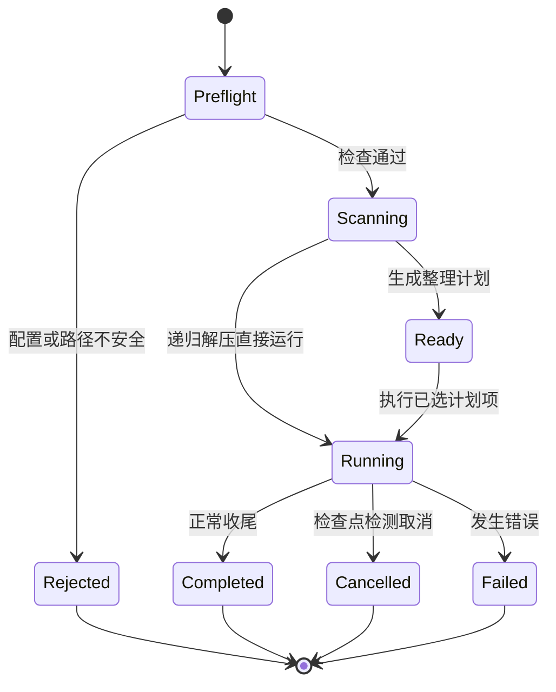

# 文件任务状态与安全边界

`file-core` 为目录整理、归档解压等文件工作流提供共用的任务底座：任务入口先验证配置和所选根目录，再扫描并把事实与计划写入任务库，最后在控制检查点执行文件操作。边界的关键不是“有一个根路径”即可，而是同一任务持续使用经过检查的规范化根、可复核的文件快照和受控的状态转换。

## 生命周期与持久状态

*图：由 `preflight_root`、共享任务库初始化及任务失败收尾所支持的主要任务状态；解压链路可由扫描直接进入运行，不必经过整理计划的 `ready` 状态。*

`task::preflight_root` 是共享安全闸门。它先按工作流分别调用 `validate_extract` 或 `validate_organizer`，然后在原始路径上检查入口链接身份，规范化根并同步规范化受保护目录；解压任务额外拒绝根目录本身为“解压失败”隔离目录，随后拒绝所选根直接含 `.git` 以及位于 Git 项目内部的根。失败会在任务数据库创建和扫描前返回，不能把拒绝降格为“跳过危险文件继续运行”。`resolve_protection` 在 Windows 上查询并规范化系统安装目录，查询失败时不静默撤销保护；非 Windows 返回无此保护根。细节由 [`fsutil`](../../crates/file-core/src/fsutil.rs) 中的路径操作模块实现。

通过预检后，`create_task_db` 获取 state 根目录互斥锁，在 `tasks` 下创建带时间和 UUID 的任务目录，事务性写入根路径、配置、初始状态、摘要、创建时间和 `state_dir`。调用者必须一直持有 `RootGuard` 到任务结束；保存 `state_dir` 可避免任务目录被移动后锁位置推导错误。数据库文件为 `task.sqlite3`；`Database::create` 初始化 schema，而既有库必须具有当前 `SCHEMA_VERSION`，不兼容即拒绝并要求重新分析，不执行旧计划或自动迁移。

目录整理会把扫描结果变成 `actions` 计划，状态为 `ready` 时才允许修改待执行项的选择；执行仅针对选中且仍待处理的动作。解压则可按扫描到的包入队并递归处理。错误收尾将摘要和状态写为 `failed`，若控制已取消则写 `cancelled`；这些容错写入失败只记录告警，不覆盖原始错误。

## 控制检查点、扫描和快照

`Control` 通过原子标志保存取消、暂停和进度计数。`checkpoint()` 先检查取消，在暂停期间通过条件变量等待并周期性复查，恢复后再次检查取消；文件操作代码应在实际工作边界遵循检查点，取消不会被误记为一般失败。进度数据（读取字节、扫描数、完成数及计划分母）用于观察，不是持久化恢复日志。

扫描器负责递归枚举、剪枝并登记文件和目录。数据库文件快照至少承载大小、修改时间、创建时间、文件身份和硬链接数；路径与快照共同用于分析阶段和执行阶段的关联。被过滤或读取失败而未登记的可见内容会记录为 `scan_taint`，空目录规划不能把有污点的目录（及向上传播受影响目录）当成可信空目录。归档入队使用相对路径、大小、修改时间和 identity 拼成 fingerprint；同一路径存在旧 pending 项时先清除再入队，避免包被覆盖后旧快照造成虚假的失败计数。

任务数据库以 `metadata` 保存 JSON 编码的 root、config、status、summary 等元数据；`files` 和 `directories` 保存盘点事实，`actions` 保存可选计划与执行状态，`events` 保存逐项审计记录，`archives` 保存待处理包，`scan_taint` 保存扫描不完整的目录事实。执行删除前先写“准备”事件，再执行删除；永久删除后将文件事实标为 inactive，避免后续查询把已删除路径当作仍存在的输入。这个事件表是审计轨迹，不是可用于回滚的恢复日志。

## 路径、保护与文件操作不变量

- 对输入根先做 `ensure_plain_entry` 再 canonicalize：规范化会丢失 reparse/link 身份，故不能调换顺序。之后相对路径通过 `relative_string` 和 `safe_join` 校验，不能把外部路径拼接进所选根。
- Git 项目根及其内部子树被整任务拒绝，以免整理或解压破坏项目结构；解压隔离目录本身不是可直接重试的根，扫描与重跑计数也排除隔离内容。
- 受保护目录必须在扫描时剪枝；Windows 上解析系统保护根失败应阻止任务启动。固定容器名称识别与保护/来源链判断由共享 `task` 逻辑维护，扩展固定容器应保持各调用方使用同一判断。
- 删除、移动和冲突目标分配均需维持根内相对路径约束。文件身份、硬链接数及快照应参与适用的删除或替换判定；`permanent_bytes` 不应把仍由其他硬链接持有的数据计为物理释放。

## 配置、日志与变更验证

配置由各工作流验证入口约束，序列化后作为任务快照保存；读旧 JSON 配置时 `Database::config` 先处理已删除设置键。schema 变化必须同步考虑版本边界：当前版本不兼容时采取拒绝并重新分析，而不是悄悄沿用旧计划。

`Job::log` 同时写 SQLite `events`、向任务事件通道发送可读日志，并对失败项采用 warning 级结构化日志。任务边界日志包含 operation、stage、耗时和错误类别/系统码，不输出错误正文；数据库边界同样记录 SQLite/I/O 类别而不记录 SQL 参数。新增日志字段或错误路径时应继续避免把文件内容、敏感路径或数据库参数泄漏到结构化日志。

扩展文件工作流时，优先复用 `preflight_root`、`create_task_db`、`Control::checkpoint`、路径校验和快照接口；不能在绕过预检后直接扫描或创建任务库。相关实现集中于 [`task.rs`](../../crates/file-core/src/task.rs)、[`control.rs`](../../crates/file-core/src/control.rs)、[`db.rs`](../../crates/file-core/src/db.rs)、[`schema.sql`](../../crates/file-core/src/schema.sql) 与 [`scan.rs`](../../crates/file-core/src/scan.rs)。路径边界合约由 [`contract_paths.rs`](../../tests/contract_paths.rs) 和 [`organizer_fs_boundaries.rs`](../../tests/organizer_fs_boundaries.rs) 覆盖；前者检验路径契约，后者针对整理工作流的文件系统边界。调整边界时应同时跑这些聚焦测试及[验证指南](../testing/validation.md)，归档解压的专有行为见[归档解压](../workflows/archive-extraction.md)，整理计划执行见[目录整理](../workflows/directory-organizer.md)。
