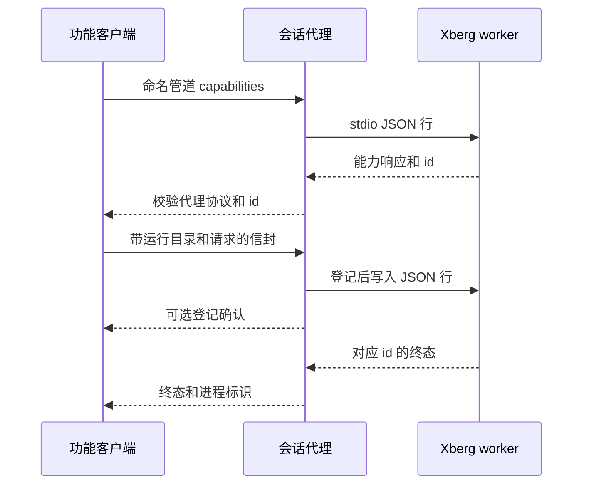
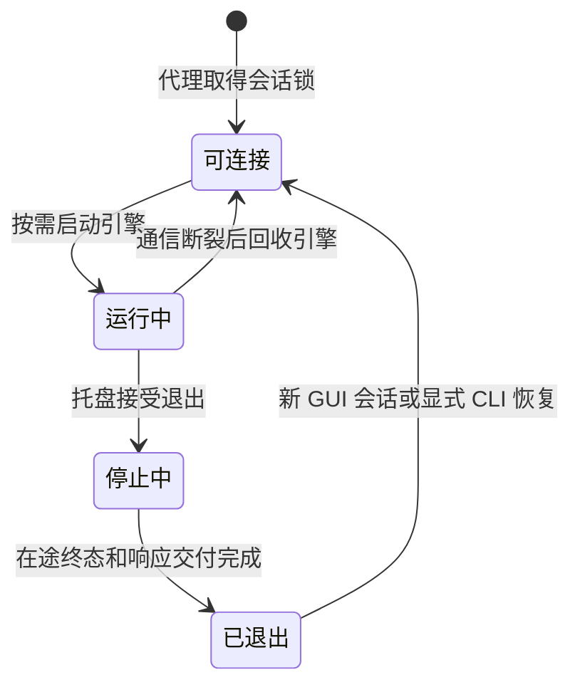

# 共享 Xberg 协议与代理生命周期

共享运行时把文档转换、媒体转录、截图服务和 `jchocr` 汇聚到同一 Windows 会话的代理，而不是让每个功能管理自己的推理进程。代理独立于 GUI 和截图服务，拥有唯一引擎槽、子进程及 Windows Job；GUI 或某个客户端退出并不因此关闭引擎。非 Windows 平台的共享运行时入口明确返回不支持。

图：能力查询与业务请求分别经过代理；登记确认不是 worker 的业务终态。

## 代理与引擎的所有权

客户端先连接本地命名管道，缺失时可启动当前可执行文件的 `--xberg-broker` 内部模式并在期限内轮询连接。代理以状态目录与 Windows 会话 ID 的散列确定管道名和会话锁，**不以 Xberg 运行目录分片**；候选代理只有取得排他锁者继续监听。管道拒绝远程客户端，安全描述符授予系统和所有者访问。另有通用 `process_identity::user_session_key` 从进程主令牌查询并缓存 SID 与会话 ID，查询失败不伪造身份；不要将它误认为此代理管道散列的具体算法。

代理按需在已保存的共享目录启动 `xberg.exe worker --no-config-discovery --config-json`，使用 stdin/stdout JSON 行，stderr 不转发。启动前枚举当前会话的 `xberg.exe`：已有实例无法接管其 stdio 时拒绝再开一个。引擎使用代理持有的 kill-on-close Job；启动配置来自 `resources/markdown-xberg.json`，媒体能力声明启用但音频 DLL 和模型惰性加载。引擎环境设置离线模式、CPU 和当前目录下的模型及运行库路径，并移除截图模型覆盖和裁剪图调试转储变量。

## 请求、能力和隔离

`extract`、`ocr_snapshot`、`transcribe` 提交前先发 `capabilities`：要求 worker 协议至少 v2、协作取消、请求超时、文档与截图并发，以及 `cancel` 和目标命令。文档后端或转录后端显式为 false 时拒绝；旧 v2 可省略这些后端布尔字段，但媒体还必须明确支持 `transcription_streaming_path`。握手失败不提交推理，也不启动备用引擎。代理自己的协议版本是 3，与 worker 的 v2 能力要求是两层不同的版本检查。

每个请求使用独立管道连接和由进程 ID、时间及计数器构造的 ID；代理信封携带规范化运行目录和请求，诊断元数据不传给外部 worker。客户端检查代理版本及响应 ID。代理先在 pending 表登记再放入唯一 FIFO 写队列，读取线程按 ID 交付终态；等待期间不持引擎槽锁。`extract` 和 `transcribe` 共用 document lane，`ocr_snapshot` 使用 snapshot lane：同 lane 前一请求未确认终态时拒绝重入，两个 lane 可以并行。pending 最多 64 项，写队列容量为 32；满载或重复 ID 明确失败，而非另起进程。

请求与响应的 IPC 消息各限 512 MiB，包含 JSON 封套，超限不截断；worker 另设置 `XBERG_MAX_REQUEST_BODY_BYTES=104857600`，不能把两个上限当成同一个。代理转发文档结果时递归去除 `pages` 和 `tables`，保留正文、告警和图片数据。截图服务与 `jchocr` 将图片字节编码到 `image_base64`；后者读取同一有效目录、检查截图资产，显式 CLI 调用还可清除托盘停止标记，但不启动 GUI 或托盘。截图客户端和 jchocr 的请求预算均为 600 秒。转换、截图及 CLI 行为分别见[转换流程](../workflows/markdown-conversion.md)和[截图与 CLI OCR](../workflows/screenshot-and-cli-ocr.md)。

## 预算、取消和故障

调用前已取消或预算为零则不提交；能力查询最多使用 15 秒，耗时从总预算扣除，连接也消耗剩余预算。代理的控制和同步 I/O 通常有 15 秒保护，业务交换另留控制余量。业务请求的登记确认只在已进入 FIFO 后发出；取消意图可以更早产生，但独立 `cancel` 连接必须等确认，携带自己的 ID 和原请求 `target_id`，因此不会越过原请求。取消接口有 1 秒期限，ACK 只表示取消接口返回，并不释放 lane 或证明原任务结束。

文档或媒体取消后原请求若一秒内仍无终态，调用者可收到明确错误，但代理保留 pending，直至真正终态或通信断裂。截图则继续等待原请求终态：不可中断的推理可能仍在运行，模型 Ready 或取消 ACK 都不够。截图原连接异常后，客户端查询**同一代理**的原请求登记，或等待该代理退出，避免把断线当成任务完成。截图终态成功但本地取消已置位时，截图客户端不展示结果；超时触发的取消终态会恢复为 `timeout` 分类。普通取消、超时或客户端断开不杀共享引擎，也不删除其他场景的请求。

迟到但仍在 pending 中的响应按原 ID 消费，即使等待端已经离开也释放其 lane；未知 ID（包括重复响应）、缺 ID、无效 JSON 或读写失败则视为协议通信断裂，所有在途请求交付 `process_exited` 失败并释放登记。超大响应若能定位 pending ID，只对该请求交付 `response_too_large` 并继续读；无法定位则同样断裂。看门狗回收断裂引擎，后续请求可重新建立能力，但不会重放失败请求。原引擎不在时，单独的取消请求返回 `accepted:false`，不为取消启动引擎。

## 后台退出和目录切换

图：代理与引擎分开拥有生命周期；退出标记阻止旧 GUI 会话立即拉起后台。

- **GUI 关闭**：只关闭界面，不拥有代理 Job；GUI 内的转换等任务仍按各自关闭确认和安全停止规则处理，不能推断它们转入后台继续运行。重开 GUI 可连接已有服务。
- **托盘退出**：`broker-stop` 设置 stopping gate，拒绝新业务，但仍解析连接以允许已登记任务的取消。看门狗等待场景 pending 清空及已登记处理器完成响应交付，再终结本应用引擎并退出代理；停止后未提交完整 JSON 的新连接不加入交付屏障。仅代理确认停止或明确未运行后写停止标记，失败和拒绝不写。`resume_background` 清除标记。
- **显式强制退出**：`broker-force-stop` 只在没有文档、媒体或尚未请求取消的截图任务时允许终结所属引擎；截图取消必须已实际进入 FIFO，ACK 仍不等于终态。它不是普通取消的实现。
- **空闲激活随包目录**：在引擎槽锁内检查没有场景任务，验证目标基础资产；必要时回收旧引擎，启动目标并握手，若需保留媒体还验证媒体资产与能力，最后才保存新目录。失败时先回收目标并尝试恢复旧引擎，原配置保留；恢复本身也可能失败。同根且健康时可保留常驻模型。普通请求遇到不同目录也不能在任务运行中切换或启动第二份。

运行期资产检查按场景检查成员存在，不以大小或 SHA-256 作准入；缺失和能力不匹配要明确报错。打包和可选音频资产下载的完整性验证是另一边界，参见[构建与交付](../operations/build-and-delivery.md)和[状态与诊断](../operations/state-and-diagnostics.md)。

## 验证边界

[共享进程测试](../../tests/xberg_shared_process.rs)覆盖真实管道和进程协作，[旧协议测试](../../tests/xberg_legacy_protocol.rs)与[未知响应测试](../../tests/xberg_unknown_response.rs)覆盖兼容性和错误路径，[后台设置测试](../../tests/background_settings.rs)覆盖后台设置。它们使用合成引擎或夹具时，只能证明所覆盖的协议及生命周期行为，**不等于真实模型、真实桌面并发或实际交付包验收**。验收目标和测试分层见[验证](../testing/verification.md)及[共享推理规格](../../openspec/specs/shared-inference/spec.md)。
