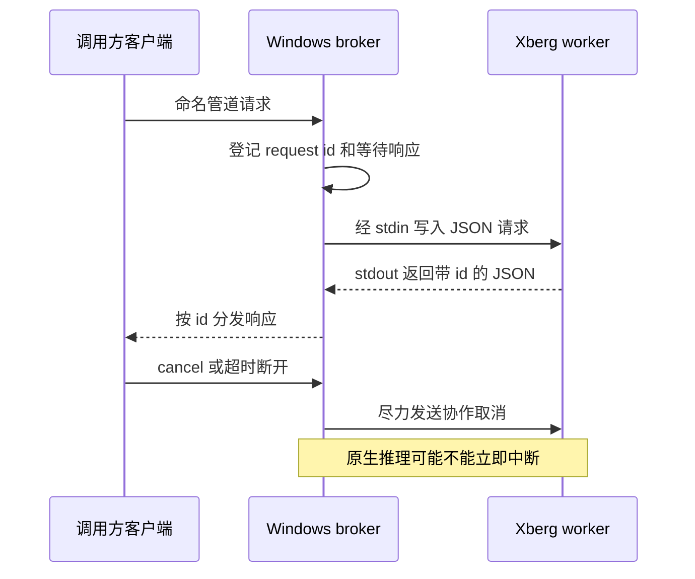

# Xberg 运行时、OCR 与托管资产

## 架构边界

Xberg 不是每个调用方各自启动的库内引擎。Windows 上，`jchtools_xberg::xberg_runtime` 为当前用户会话提供唯一 broker（代理），broker 持有唯一 worker `xberg.exe`；GUI、截图 OCR、控制台 `jchocr` 和 Markdown 转换等客户端按请求连接命名管道。broker 和管道身份不随运行目录变化，因此用户切换保存目录不会并行启动第二个引擎。客户端断开不关闭 worker 的 stdin，也不应中断其他请求。非 Windows 的共享运行时入口明确返回仅支持 Windows 的错误。

*图：客戶端通過 broker 的請求關聯與 worker 標準輸入輸出協議；取消是协作式而非强制杀死 worker。*

`request` 先检查取消和时限，为 `extract`、`ocr_snapshot`、`transcribe` 执行能力握手，再把握手时间从请求预算中扣除，生成唯一 ID 并提交 broker。握手要求协议版本至少 2、合作式取消、超时字段、文档快照并发和对应命令支持；文档与媒体还会检查相关后端能力。失败时不回退启动私有备用引擎，也不会提交该次推理。单条 IPC 请求/响应上限为 512 MiB，超过上限应失败而非截断。

Windows broker 通过 pending 请求表将 worker 响应按 ID 交回各自客户端，并管理请求级 deadline、取消和并发 lane。取消不等于原生调用已终止：当 worker 已进入不可中断原生计算时，取消 ACK 不能保证立刻产生原请求终态。停止期间 broker 的 stopping gate 拒绝新业务，但仍解析已登记任务的取消，使停止流程能够收束；查询/停止后台状态不启动缺失引擎。新 GUI 会话可恢复后台服务，托盘退出后当前会话不会自动复活；只有用户显式强退且没有其他场景任务时才终结本应用引擎。

## 文档转换客户端

`crates/markdown/src/markdown_document.rs` 是本地 Rust 薄适配器：只向已初始化的共享 `xberg.exe` 发送 `command` 和文件 `path`，不启动 HTTP 服务或 Python。页数分流、嵌入文档合并和 Markdown 规范化归引擎负责；适配器解析 `document.content`、如实转达警告，并按引擎公布的调用约定处理图片引用和待落盘媒体字节。不要在适配层复制引擎的转换规则。`convert_cancelable` 将 deadline/取消边界用于上层流程。

## 截图 OCR 与图片 OCR

截图 OCR 的 GUI 工具页打开时只在后台线程离线检查现有安装，不联网；显式初始化才下载可选组件。截图服务控制客户端 `snap_pipe_request` 每条命令新建管道连接，服务重启无需复用失效句柄。连接等待最多约 2 秒，响应读取默认 10 秒；读取放在单独线程并有 deadline，超时通过取消管道 I/O 清理阻塞读，避免唯一监督线程永久卡住。服务命令包含 `ping`、`get-state`、`capture`、`retry-load`、热键/自启动配置及 `exit`。

独立 `jchocr` 接受绝对图片路径、HTTP(S) URL、stdin 原始字节或 Base64 输入，调用共享截图运行时的 `ocr_snapshot` 路径。默认 stdout 输出 OCR 原文，`--json` 输出结构化结果；错误写 stderr，并区分参数/输入、Xberg/资产、网络、推理和运行时失败。无识别文字仍是成功结果。它不是另一个常驻 OCR worker。

## 资产获取、校验与生命周期

资产分为两类：固定版本、来源与 SHA-256 校验的结果窗字体随主程序清单提供；模型、推理运行库和 `xberg.exe` 等重资产位于应用级 SQLite 设置所指的共享目录，按截图、文档、媒体场景清单检查。主程序包不携带这些重资产。场景清单将模型依赖隔离，公共运行库和 worker 对各场景共同必需；运行时资产校验关注场景必需成员是否存在，替换版文件在场时不会仅因大小或摘要与清单不同而被拒绝。

资产安装采用 staging、校验、原子落位：失败或取消清理本轮 staging，不覆盖已验证的完整资产；重试复用已验证内容。截图 OCR 的联网获取仅由用户在界面主动初始化触发，打开页面只做离线 readiness。随包运行时可通过 broker 的空闲边界激活；激活失败不提交新的资产来源，也不打断在途推理。能力握手和场景资产缺失是提交请求前的硬边界，不应通过偷偷启动另一 worker 绕过。

## 故障与运维检查

- `Xberg 共享接口不可用` 或能力不匹配：检查已安装 worker 版本及能力协议，不要将其解释为单次识别失败；调用方在握手失败时不提交推理。
- 场景资产缺失：按错误指示的成员修复相应场景安装；仅有文件在场检查的共享运行时规则，不等同于完整性摘要认证。
- IPC 超时/取消：请求级取消是 cooperative；某些原生推理可能继续运行至返回。截图控制 IPC 有独立有限读取时间，避免 UI 永久等待。
- broker 生命周期操作只适用于应用拥有的后台进程；不要把查询或退出接口当作自动启动接口。
- 诊断日志记录命令类别、阶段、耗时和错误类别，不应依赖日志正文承载 OCR 文本、图像或敏感请求内容。

## 验证重点

`tests/xberg_shared_process.rs` 覆盖真实 broker 与命名管道、请求关联、并发/取消、后台停止及子进程生命周期，使用模拟 worker，不代表真实模型精度验收。`tests/xberg_assets.rs` 验证固定清单和场景成员分类、缺失路径报错及替换文件的存在性口径，不启动 broker/worker。截图资产模块的单元测试覆盖 readiness、staging、下载与安装；GUI 管道请求测试覆盖超时恢复。改动 broker 协议时同时检查客户端能力握手与 worker 能力声明；改动资产规则时同步清单和场景分类测试。
