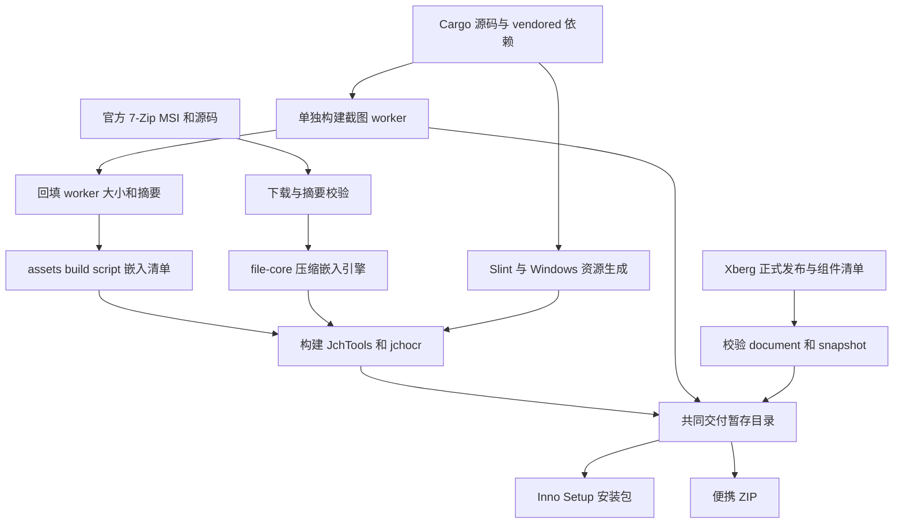

# 构建、资产装配与 Windows 交付

Windows 发布并非一次普通的 `cargo build`：打包脚本先准备并校验外部输入，再分别构建截图 worker 和主程序，最后把同一棵已校验的运行目录交给安装器和 ZIP。7-Zip 是压缩后内嵌、运行时释放的引擎；worker 是独立随包可执行文件；Xberg 则是构建期准备、随包交付的基础运行树。这三者不能互相替代。



图：构建输入经独立校验和生成步骤后汇入共同暂存目录，再形成两种交付物。

## 工具链与构建边界

在仓库根目录的 Windows PowerShell 执行打包。需要 x64 MSVC Rust 工具链、Visual Studio C++ Build Tools、Windows SDK 和 Python；安装包还需要 Inno Setup 6。脚本检查宿主为 `x86_64-pc-windows-msvc`。仓库声明 Rust 最低版本 1.98.1，CI 固定同一版本；`.cargo/config.toml` 使用 vendored crates、Windows 目标的 `+crt-static`，本地默认 16 个构建任务，CI 以 `CARGO_BUILD_JOBS=4` 覆盖。

```powershell
.\scripts\package-windows.ps1
.\scripts\package-windows.ps1 -SkipTests
.\scripts\package-windows.ps1 -Offline -SkipTests
```

默认输出 `dist`；`-DestinationRoot` 可指定其他输出根，非绝对路径相对仓库根解析。`-Offline` 不准备网络资产：须预先备齐已校验 7-Zip、Cargo 依赖及 Xberg 锁定发布元数据和缓存；离线缓存的版本不宣称仍为 latest。默认不带 `-SkipTests` 时脚本运行非桌面 `cargo check`、nextest、文档测试及指定的真实 7-Zip ignored 测试，需相应工具和资产；桌面验收仍需单独授权。`-SkipTests` 只跳过测试，不跳过资产及打包校验。

根 package 默认启用 `gui`，`JchTools` 二进制要求该 feature；`mcp-server` 是调试用途，不用于发布。工作区默认成员包括生产 crate，不包括两个 optional 截图包；打包显式以 `--manifest-path optional/snap-ocr-worker/Cargo.toml --bin snap-ocr-worker` 构建 worker，再以 `-p jchtools -p jchocr --bins` 构建主程序和 CLI。两次均使用 `--locked --release --target x86_64-pc-windows-msvc`。

构建脚本各自负责不同生成物：`crates/ui/build.rs` 编译 `ui/app.slint`，监听整个 `ui/` 和图标；关闭 `gui` 时不生成 Slint 代码。根 `build.rs` 处理 Windows manifest 和 EXE 图标，找不到 `rc.exe` 时警告而非终止。`crates/assets/build.rs` 将截图清单复制到 Cargo 的 `OUT_DIR`；`crates/file-core/build.rs` 在自己的 `OUT_DIR` 生成内嵌引擎代码与状态文件。这些输出属于对应 Cargo 构建，不应以历史目录时间猜测当前结果。

## 7-Zip：获取、内嵌与释放

[`fetch-7zip.ps1`](../../scripts/fetch-7zip.ps1) 在构建机查询官方 GitHub release，要求 MSI 和对应源码资产具有上游 SHA-256；缓存复用前重新哈希，不使用镜像回退。它在独立暂存目录通过 MSI 管理映像提取完整 `7z.exe` 和 `7z.dll`，检查 RAR 支持，准备许可、源码和 `manifest.json`。相同字节不重复改写输入，避免不必要的 Cargo 重建；`resources/7zip/` 是生成资产，不应提交。

file-core 按目标平台选引擎文件，核对清单 SHA-256，再压缩写入 `OUT_DIR` 并生成 `include_bytes!` 代码。普通编译缺少完整引擎时只警告并标记 `incomplete`；清单条目缺失或摘要不符则拒绝构建。打包从本次 Cargo JSON 消息中定位实际 file-core 库及其 build-script `OUT_DIR`，要求 `engine_embed_status.txt` 为 `ok`，否则 fail-closed。运行时从内嵌内容释放到用户数据目录并校验摘要，而不是下载引擎；最终包不放独立 `7z.exe` 或 `7z.dll`，但保留清单、NOTICE、许可证和经校验的上游源码归档。运行时解压行为另见[递归解压](../workflows/recursive-extraction.md)。

## 截图 worker 与清单

仓库的 `resources/snap-ocr-assets.json` 中 worker 条目是 `pending-build`，不是已发布二进制的承诺。打包先构建 worker，从本次 Cargo artifact 取得实际路径，计算大小和 SHA-256，校验固定 URL、安装路径等清单结构后，将副本回填为 `ok`。回填清单以内容摘要命名，放在实际 worker 产物旁；通过 `JCHTOOLS_SNAP_OCR_MANIFEST` 输入主构建，并在构建后恢复调用者环境。嵌入清单与交付目录 `resources/snap-ocr-assets.json` 使用同一字节，`snap-ocr-worker.exe` 则独立放在主程序旁，不嵌入主程序。打包也校验 worker 内嵌字体及其许可证的固定大小和摘要。

`dist/optional-components-v0.1.2` 是本地回填暂存，不代表已经上传可选资产；发布此类资产需另行授权。截图和 CLI OCR 的运行期边界见[截图与 CLI OCR](../workflows/screenshot-and-cli-ocr.md)。

## Xberg：基础树与可选组件

[`prepare-xberg-runtime.ps1`](../../scripts/prepare-xberg-runtime.ps1) 是构建辅助工具，而不是 `build.rs` 或运行时自动下载器。在线模式解析 Xberg 正式 latest，核验 release 状态、固定来源 URL、API 的大小和 SHA-256，并对组件清单和下载字节交叉校验。只下载 `document`、`snapshot` 和 manifest；`media` 与音频归档不随默认包下载，音频的来源和成员记录仍写入来源记录，供后续可选组件流程使用。

脚本在隔离 staging 中检查 ZIP 根路径、路径安全、重复或链接成员、每个成员大小与摘要，共享文件必须字节一致；还对照仓库固定模型身份，拒绝额外模型与音频资产。验证通过后将基础成员及 `jchtools-xberg-release.json` 复制到目标，保留已有音频和无关文件，再复核基础字节。打包随后对整棵树执行 `-ValidateOnly`，并检查整包不得散落音频专属资产。此构建辅助复制过程不是整棵目标树的原子替换。

与此不同，运行期资产安装共用的文件/目录原子落位先把旧目标改名备份，再把已暂存资产改名就位；关键替换失败会尝试恢复，恢复也失败时报告备份位置，旧资产仍保留在那里。成功后清理旧备份失败不撤销成功。不要把这一通用安装机制误读为运行时自动获取 Xberg 基础组件；共享引擎与可选组件详见[共享 Xberg](../integrations/shared-xberg.md)。

## 两种产物与验证记录

共同暂存树包含主程序、`jchocr.exe`、worker、Xberg 基础树、清单、文档和许可证。脚本根据 `cargo metadata --locked` 的实际依赖图及 `vendor/SOURCES.json` 收集 Rust 依赖许可，校验后再打包。安装器从同一树编译：默认按当前用户安装，不要求管理员权限，创建开始菜单、默认桌面快捷方式和卸载项；`jchocr.exe` 放到已有用户 PATH 的 WindowsApps 目录，不修改 PATH。升级或卸载前安全停止 CodeAgent 后台，不能安全停止则拒绝替换或删除。用户数据默认保留。便携 ZIP 保留顶层目录，解压后可直接运行主程序或 CLI。安装器编译前写入的 `BUILD-INFO.json` 不能预报安装器成功；便携目录在编译后更新状态再压缩。本地缺 ISCC 时安装器标为 NOT RUN，仍可生成 ZIP，因此不能仅凭脚本结束声称双产物齐全。

每次打包在 `.tmp/package-windows-<独占标识>/timings.jsonl` 独占创建记录文件，以追加、逐行 flush 的完整 JSON 快照记录各阶段与 total 的墙钟状态；读取最后一条完整 JSON 行，忽略可能不完整的末行。失败保留已写记录并标记失败，尚未执行阶段为 `NOT_RUN`。墙钟包含 Cargo 命令开销，不等于纯编译预算，也不随包发布。

## CI、授权与验收

[`check.yml`](../../.github/workflows/check.yml) 和 [`release.yml`](../../.github/workflows/release.yml) 均为手动触发的 Windows 构建：运行 `package-windows.ps1 -SkipTests`，不运行测试、lint 或质量门。前者上传构建产物；后者确保 Inno Setup 可用，要求恰好一个 ZIP 和安装包，生成两者的 SHA-256 清单并创建 GitHub Release。CI 成功不是功能或桌面验收。发布须当次单独授权；未要求等待时报告对应 run 链接及未完结状态，只有确认该最终 run 成功且实际产物存在，才能报告发布成功。

执行或修改前遵守根目录 [AGENTS.md](../../AGENTS.md) 的授权、缓存和验证规则：fulltest、slowtest 及真实桌面分别受授权约束；保留有效 `target/` 与构建维度，不以清缓存或历史成功替代本轮检查。针对变更选择相关测试，例如引擎完整性及归档测试、截图清单/原子落位测试、Xberg 资产测试和安装包内容校验；实际未运行的项目须如实标记。完整测试范围与证据口径见[验证](../testing/verification.md)，状态及日志见[状态与诊断](state-and-diagnostics.md)。
