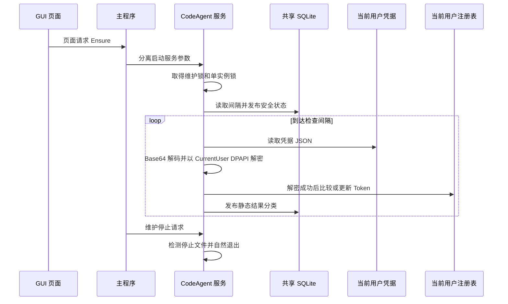

# 设置与后台服务

设置存储和后台服务是跨 GUI、主进程与独立进程的边界。共享设置由 foundation 提供统一的用户数据目录和 SQLite；CodeAgent 服务由 GUI 请求启动，但其生命周期不依赖窗口，持锁轮询并以静态结果报告凭据检查状态。

## 共享设置持久化

`crates/foundation/src/app_settings.sql` 定义唯一 `app_settings(key TEXT PRIMARY KEY, value TEXT NOT NULL)` 表，并启用 `PRAGMA synchronous=FULL`。`xberg_settings` 通过 `state_dir()` 使用 JchTools 用户本地数据目录；生产策略不读取测试目录环境变量。测试可显式隔离状态目录。CodeAgent 也复用此目录和表，而不是另建数据库。

Xberg 的设置由 `xberg_settings::settings()` 读取：它保留 custom、downloaded、bundled 各自目录，并以 `xberg_source` 决定当前目录。来源和路径在同一读取事务快照中读取，避免并发来源切换产生“来源是新值、路径是旧值”的混合状态。保存前检查绝对路径、目录和 `xberg.exe`，规范化路径后将来源及路径放在同一 SQLite 事务提交；失败时事务不覆盖有效配置。旧版单一路径和文本配置按需迁移，迁移失败保留旧来源并可附带警告；失效路径保留供用户修复。有效用户/下载来源优先，失效或缺失时才尝试随包目录。

配置数据库错误通过错误结果返回，日志仅记录操作阶段、错误分类和耗时，不记录数据库值或用户配置正文。常规连接默认 SQLite busy timeout 为 5 秒；后台服务可选择零等待连接，避免数据库争用阻塞凭据维护。

## 后台进程生命周期

主程序 `src/main.rs` 将 `--codeagent-service` 和 `--xberg-broker` 分支分派到独立服务入口。后台共用日志初始化、失败事件上报、刷盘和退出码处理。GUI 进入 CodeAgent 页面时，经观察线程发出 Ensure 命令；Windows 上 `ensure_started()` 以 `CREATE_NO_WINDOW | DETACHED_PROCESS` 启动当前可执行文件的服务参数，并最多等待 5 秒观察服务状态。GUI 线程不直接执行耗时操作。

CodeAgent 服务先取维护控制锁，再取单实例锁；锁争用表示已有维护或服务进程，按预期情况退出，不启动第二份。服务持有单实例锁直到进程退出，发布 PID 文件，并每秒检查停止请求和已保存间隔。间隔缺省 60 秒，必须是正整数秒；保存的新值可被轮询热应用。状态写入失败不会停止凭据检查，读取间隔失败则暂时沿用上次有效值（初次读取失败使用 60 秒）。

图：从 GUI 请求、服务单实例启动，到周期性凭据检查与维护请求自然退出；图中不包含任何凭据值。

## CodeAgent 凭据维护与安全不变量

生产凭据来源是 `%USERPROFILE%\\.cac\\.credentials.json`，读取 JSON 的 `idaasOAuth.xAuthToken` 字段。服务将其按 Base64 解码，再使用 Windows DPAPI `CryptUnprotectData`，限定 `CurrentUser`、空熵并禁止交互。只有读取、解析、解码、解密和 UTF-8 校验全部成功后，才尝试写 `HKEY_CURRENT_USER\\Environment` 下的 `JCH_CODEAGENT3_X_AUTH_TOKEN`。写前比较现值：相同则返回 Unchanged，不作写入；空值或含 NUL 的 Token 拒绝写入。

任何读取、格式、解密、UTF-8 或注册表失败都返回固定 `CheckResult` 分类，保留已有注册表 Token。DPAPI 解密缓冲区在释放前清零；解析错误正文、密文和明文不进入状态、GUI 或日志。SQLite 只持久化检查间隔及 JSON 化的状态（运行标志、PID、检查时间、结果分类），不存储凭据或 Token。GUI 展示分类文本和时间，而不是凭据内容。

维护停止不依赖 SQLite：调用方在控制锁下写停止请求，等待服务进程句柄最多 15 秒，并确认单实例锁释放；不会强杀服务。服务检测到请求后尽力发布 stopped 状态，但即使状态库不可写也会正常退出。安装器可据此在镜像替换前等待独立后台释放文件锁。

## 操作与验证

- 修改共享设置 schema 时同步考虑 foundation 所有使用者；CodeAgent 以固定键名共享 `app_settings`。
- 检查间隔仅接受正整数秒；数据库暂时不可用时服务继续使用上次有效值，不应以存储失败中止维护。
- GUI 重新进入 CodeAgent 页面会确保后台启动；窗口关闭本身不终止服务。需维护/替换程序文件时，应发停止请求并确认锁释放。
- `tests/background_settings.rs` 覆盖共享设置与后台相关行为；`tests/codeagent.rs` 覆盖 CodeAgent 检查、失败时保留 Token、间隔和后台生命周期。隔离测试使用 `test-hooks` 的显式凭据、注册表及状态目录配置，避免接触真实用户资产。

相关内容：[应用架构](../architecture/application.md)、[Xberg 与 OCR 集成](../integrations/xberg-and-ocr.md)、[构建与诊断](build-and-diagnostics.md)。

## 关键实现位置

- 共享 SQLite schema 与设置 API：[`app_settings.sql`](../../crates/foundation/src/app_settings.sql)、[`xberg_settings.rs`](../../crates/foundation/src/xberg_settings.rs)
- 服务启动分派：[`main.rs`](../../src/main.rs)
- CodeAgent 服务、DPAPI 与注册表维护：[`codeagent.rs`](../../crates/codeagent/src/codeagent.rs)
- GUI 请求与状态回显：[`codeagent.rs`](../../crates/gui/src/gui/codeagent.rs)、[`wiring.rs`](../../crates/gui/src/gui/wiring.rs)
