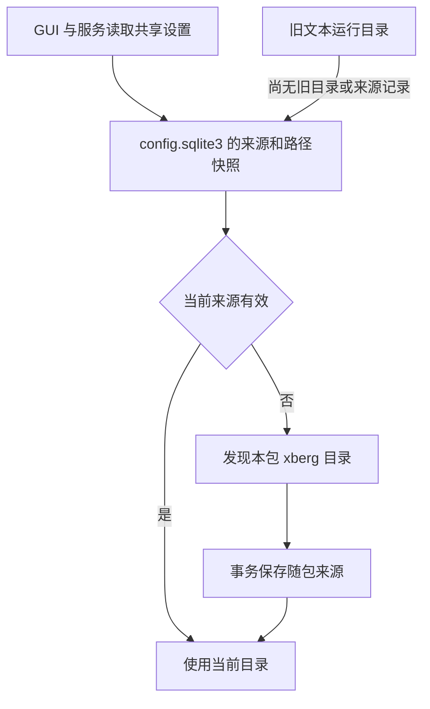

# 应用设置、状态目录与诊断日志

排障时先确认证据属于哪个所有者：共享状态根不意味着所有数据都在同一个数据库，也不意味着界面可见的运行日志就是磁盘诊断日志。

| 状态 | 所有者与用途 |
| --- | --- |
| `config.sqlite3` | foundation 的共享应用设置库，`app_settings` 保存 Xberg 来源和目录，也保存 CodeAgent 检查间隔及去敏状态。不是任务审计库。 |
| `task.sqlite3` | 文件任务目录中的任务库，记录任务及其配置快照和审计数据；文件工具规则本身只在会话生效，不提供独立配置文件读写。任务安全边界见[文件任务安全](../concepts/file-task-safety.md)。 |
| CodeAgent 锁及停止请求 | 状态根中的锁文件和停止请求用于后台服务协调；凭据不是数据库里的配置正文。见 [CodeAgent 维护](../workflows/codeagent-maintenance.md)。 |
| 界面运行日志 | 面向当前界面的最近 300 条，不导出；不等于独立持久化的诊断文件。 |
| `logs/` | 常开、按进程启动隔离的本地诊断日志，用于关联 IPC、任务、下载和失败。 |
| `perf-logs/` | 仅启用 `perf-tracing` 时的性能数据，独立于界面与诊断日志。 |

默认状态根由 `ProjectDirs` 的 JchTools 用户本地数据目录确定。测试或 `test-hooks` 构建可用绝对路径 `JCHTOOLS_TEST_STATE_DIR` 隔离；相对路径报错而不回落真实用户目录。生产策略不读取这些测试覆盖变量。应用设置连接初始化共享 schema，使用 `synchronous=FULL`，通常等待 SQLite 锁最多五秒；CodeAgent 后台维护使用零等待连接，以免存储争用阻塞凭据检查。

## 共享 Xberg 设置和迁移

图：共享设置优先于随包发现；旧文本仅在相应数据库记录缺失时参与迁移。

`settings()` 在同一读事务中取得来源及各路径，避免另一进程提交切换时混合不同快照。`custom`、`downloaded`、`bundled` 各自保留路径，但只有所选来源生效；缺省来源为 `custom`。保存要求绝对目录、存在 `xberg.exe`，并规范化路径；来源、来源专属路径和兼容旧版的 `xberg_directory` 在同一事务提交。切换不会删除其他来源，失败不应覆盖有效配置。

旧文件位于状态根 `markdown-assets/xberg-runtime-path.txt`。没有旧目录或来源记录时才尝试迁入；旧文本保留，写入失败时仍可使用原目录并显示迁移未保存警告。旧路径无效时保留以供修复，不应误报迁移成功。`load()` 的兼容接口对空值或非绝对路径报错；实际生效目录还须通过目录及 `xberg.exe` 存在性检查。

有效的当前来源优先；否则先检查当前可执行文件旁的 `xberg/`，成功后以事务保存随包来源，并在事务内再次检查当前配置，避免覆盖并发写入的有效来源。普通便携包或安装包缺少本包引擎时，不偷偷选择另一安装。只有真实用户 `WindowsApps` 中的独立 `jchocr.exe` 可回退到安装器登记的 `HKCU\Software\JchTools\InstallDir`。找不到有效目录时 `required()` 报错；GUI 设置页依据唯一生效目录检查组件成员和发布记录，不因此加载模型或联网。更完整的代理与资产关系见[共享 Xberg](../integrations/shared-xberg.md)。

## 常开诊断日志

P-10 要求本地记录关键操作的开始、结果、耗时和安全摘要，覆盖共享代理及引擎、网络下载重试、文件任务与 panic；不上传日志或记录截图、识别文字及文件正文。具体契约见 [P-10](../../openspec/specs/application-contract/spec.md)。

每次真实启动独占 `logs/jchtools.<UTC日期>.<pid>-<启动纳秒>-<序号>[.<分段>].log`，按日及大小轮转，单文件最多 1 MiB，每个落点自有日志最多 10 个，最长保留 14 天；数量限制可提前淘汰旧文件，不能清理归属不明文件或直接截断历史超大文件。主目录不可用时尝试当前用户 `LocalAppData/JchTools/Logs`；测试构建使用隔离根下 `logs-fallback`。两处失败仅向 stderr 报告安全错误类型和码，业务继续；写入失败也不能改变业务结果。

事件为带 UTC 微秒时间、级别、PID、线程、组件、稳定事件名及 span 链的单行 `key=value`。操作 ID 用于关联跨步骤证据。`JCH_LOG_LEVEL` 接受 `debug`、`warning`、`error`，其他值默认 INFO；不读取 `RUST_LOG`。阈值过滤事件但保留 INFO 关联 span。文本长度受限，控制字符转义，已知凭据及 URL 去敏；调用方仍不得提交文件、OCR、模型、终端或协议正文。panic 日志只记录负载类型和源码位置等元数据，不能把脱敏当作允许记录原始敏感内容的许可。

GUI 在窗口创建前初始化，局部 guard 在返回时刷盘；主程序的 CodeAgent 和 Xberg broker、截图 worker 服务及其 broker 将 guard 登记为进程级，并在服务返回或主动退出前刷盘，`FlushOnDrop` 兜住展开路径。`jchocr` 识别路径也登记并刷盘，其帮助、版本和参数解析错误在日志初始化之前返回。启动事件的角色依据内部模式和程序名判断，构建模式描述实际 `debug_assertions`，不是 Cargo profile。另一个不同的身份是管道及单实例使用的 Windows 用户 SID 与令牌会话 ID：取自当前进程主令牌并缓存，查询失败不生成替代身份；它不是日志的启动 ID。

## 性能数据不是诊断日志

`perf-tracing` 默认关闭，未启用时性能 span 宏不生成打点；常开诊断仍可运行。启用后性能层与诊断层共用 tracing registry，但只接收 `perf` target，写入 `perf-logs/<本次进程标识>/jchtools-perf.log.<日期>`，按日轮转，不写控制台。span 关闭事件包含 `time.busy` 和 `time.idle`，任务结束事件包含工作量计数；高频逐文件循环刻意不打 span。名称和字段语义是跨版本比较契约。目录或 subscriber 初始化失败会静默关闭性能采集，不改变业务；guard 必须活到退出前才能刷盘。这些机制不是已执行基准或性能结论。

## 定位与验证

1. 确认运行用户、进程角色、启动时间和实际状态根，再按启动事件、PID、操作 ID 串起 GUI、broker、worker 或 CLI 的各自文件；重启后不要假定仍写入同一个文件。
2. 设置问题先查 `config.sqlite3` 中当前来源与路径，再检查对应目录和 `xberg.exe`，以及 GUI 的迁移警告；不要用任务目录中的 `task.sqlite3` 代替应用配置。日志不可用时检查备用落点和 stderr，注意保留期与数量限制可能已清理旧证据。
3. 测试覆盖包括 `tests/xberg_settings.rs` 的隔离迁移和共享设置、foundation 的并发快照与随包发现、`tests/background_settings.rs` 的后台设置、`tests/gui_log_panel.rs` 的界面日志，以及 logging 和 perf 模块的隔离与失败测试。这些是测试入口而非本页声称已经执行的结果；验证策略见[测试与验证](../testing/verification.md)。构建与发布约束见[构建与交付](build-and-delivery.md)。
