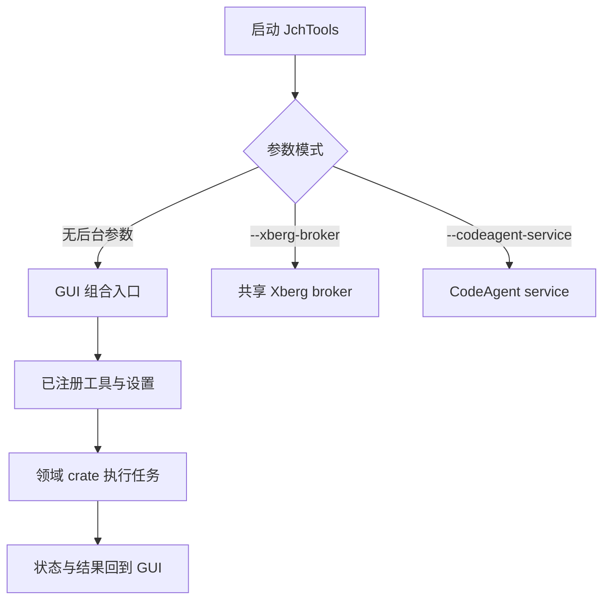

# 开发者快速入门与任务地图

## 先认识工作区

这是 Windows 优先的 Rust + Slint 桌面工具箱，根 `Cargo.toml` 定义包 `jchtools`、默认 GUI 特性和 Cargo workspace。生产代码分布在 `crates/`；根包的 `src/main.rs` 是薄入口：默认启动交给 `jchtools_gui::gui::run()`，并识别 `--xberg-broker`、`--codeagent-service` 两种后台进程模式。GUI 由 `gui` 默认特性启用；可选的 `mcp-server` 是测试/调试用途，不能用于生产发布。

MSRV 在 `Cargo.toml` 中为 Rust 1.98.1；Windows 构建还依赖 MSVC C++ Build Tools 与 Windows SDK。产品面向 Windows，跨平台构建/测试不等于 Windows GUI、打包或真实运行时验证。

```powershell
cargo check
cargo test --workspace
cargo run
```

根目录运行 Cargo 命令即可覆盖默认成员。可用 `cargo test -p <crate>` 聚焦单个 crate；改动跨组件时再运行完整适用测试。具体 feature、目标平台、打包流程及质量门会影响测试边界，不要把一次 `cargo check` 或 CI 打包结果描述成完整验收。详见[构建与诊断](operations/build-and-diagnostics.md)和[验证策略](testing/validation.md)。

## 入口与控制流概览



该图概括根二进制分支及 GUI 的领域分工；各领域内部任务细节见对应专题。

## 按变更路由

| 你要改什么 | 从这里开始 |
|---|---|
| 应用启动、Slint 页面组装、GUI 后台任务、事件和取消 | [应用架构](architecture/application.md) |
| Rust 特性、Windows 编译/打包、依赖资产、日志与故障诊断 | [构建与诊断](operations/build-and-diagnostics.md) |
| 测试入口、平台/feature 门、集成及端到端验收 | [验证策略](testing/validation.md) |
| 文件扫描、任务状态、路径安全及共享文件基础设施 | [文件任务与安全边界](concepts/file-tasks.md) |
| Xberg 运行时、共享代理、OCR 与托管资产 | [Xberg、OCR 与托管资产](integrations/xberg-and-ocr.md) |
| 配置持久化、后台服务生命周期 | [设置与后台服务](operations/settings-and-services.md) |
| 递归解压、目录整理、Git、Markdown 相关工作流 | [解压](workflows/archive-extraction.md) · [目录整理](workflows/directory-organizer.md) · [Git 工具](workflows/git-tools.md) · [Markdown 工具](workflows/markdown-tools.md) |

## 验证原则

先运行与修改面相称的 crate 测试，再按[验证策略](testing/validation.md)检查平台和 feature 要求。GUI、真实引擎/模型和发布打包各有独立验证边界；需要无头 GUI 端到端时遵循仓库根目录 [`e2e.md`](../e2e.md)，其 MCP 测试构建不能替代生产构建。涉及发布资产或 Windows 运行行为时，应在 Windows 上按[构建与诊断](operations/build-and-diagnostics.md)执行相应验收，并如实记录未运行的项目。
