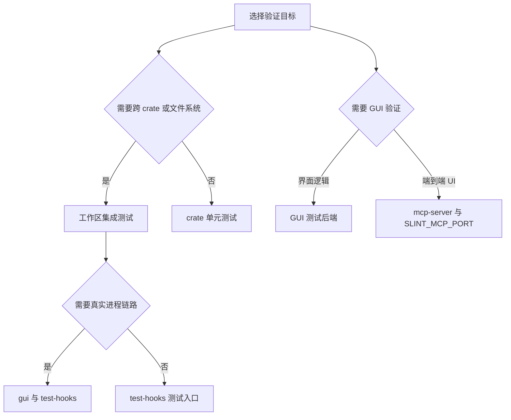

# 测试与验证策略

仓库测试按风险边界分层：各 crate 的单元测试覆盖局部逻辑，根工作区集成测试验证跨 crate 的文件系统与进程协议，GUI 测试验证 UI 行为，而 `e2e.md` 描述借助 Slint MCP 的无头端到端检查。测试入口并非一律编译所有能力；Cargo 的工作区成员、默认成员和显式 feature 门禁共同决定实际覆盖面。

## 工作区与常用入口

`Cargo.toml` 把生产 crate 纳入 workspace，默认成员覆盖根包及主要 crate；`optional/snap-ocr-core` 与 `optional/snap-ocr-worker` 是 workspace 成员但不在默认成员中，需通过对应 manifest 等显式入口验证。默认 feature 是 `gui`，因此根包默认构建包含 GUI；根包的 `JchTools` 二进制要求 `gui`。根包 dev-dependencies 还包含各功能 crate 与测试辅助库，支持根目录 `tests/` 中的跨组件集成测试。

一般可从工作区默认目标开始：

```sh
cargo test
```

针对不需要 GUI 的构建/测试，可显式关闭默认特性；启用需要根二进制或受保护测试入口的测试，则必须按目标要求开启特性。不要把 `cargo test --no-default-features` 当作 GUI 或进程集成覆盖的替代品。

## 特性门禁与测试隔离

根包的 `test-hooks` 将仅测试用入口分别映射到多个 crate。它用于集成测试隔离，不应作为产品功能依赖。Cargo 明确标注 `codeagent`、`xberg_shared_process`、`background_settings`、`xberg_unknown_response` 和 `xberg_legacy_protocol` 要求 `gui` 与 `test-hooks`；`xberg_settings`、Markdown 转换门禁及媒体端到端测试只要求 `test-hooks`。这些声明既是编译边界，也是运行真实根程序内部入口的约束。

`mcp-server` 同样是调试/测试特性，会编入 Slint MCP 支持，并依赖 GUI；Cargo 注释明确禁止生产与发布构建启用。运行时由 `SLINT_MCP_PORT` 激活。`perf-tracing` 则跨多个 crate 统一打开性能打点，不是一般测试所需的特性。

## 集成测试：文件系统与进程边界

`tests/organizer_fs_boundaries.rs` 面向目录整理器与真实文件系统边界。检查涉及临时目录时，应重点关注实际落盘结果、边界输入以及失败后是否留下部分状态，而非只验证纯函数返回值。它与 [文件任务](../concepts/file-tasks.md) 所述的文件操作风险属于同一验证层。

Xberg 集成用例区分“模拟推理引擎”与“真实进程”。`xberg_shared_process` 依赖 `gui` 和 `test-hooks`，从真实主程序进程启动内部代理入口，但使用测试合成引擎来验证共享进程协议及其生命周期；它不是对真实模型服务或真实推理引擎的验收。其他同组用例分别覆盖未知响应、旧协议拒绝共享推理能力以及后台设置生命周期。纯设置测试不要求 GUI，体现了无 GUI 的协议/状态验证与真实二进程链路之间的边界。关于集成机制参见 [Xberg 与 OCR](../integrations/xberg-and-ocr.md)。

## GUI 与无头端到端

GUI 单元测试位于 `crates/gui/src/gui/gui_tests.rs`，用于验证 GUI 层逻辑；Slint 测试后端通过 dev dependency 提供，避免把界面逻辑测试等同于用户环境中的完整图形会话。更完整的无头检查见根目录 [`e2e.md`](../../e2e.md)：其基于 MCP 构建，使用元素树查询、截图和交互检查实际 UI。只有启用 `mcp-server` 编译支持并配置 `SLINT_MCP_PORT` 才能使用该路径；这属于专用测试构建，不应混入发布产物。



该图概括按验证风险选择测试层级及其 feature 门禁。

## 失败定位与维护建议

测试未被执行与测试失败是不同问题：先检查 `Cargo.toml` 中目标的 `required-features`、默认成员范围和目标平台条件，再判断断言或环境故障。跨进程测试失败时，区分测试钩子未启用、二进制入口未编译、协议行为不符与合成引擎生命周期故障；无头 GUI 失败则先确认启用了 MCP 编译特性并设置端口。Windows 专属依赖和代码由 `cfg(windows)` 限定，跨平台 CI 必须结合工作流矩阵解释哪些平台实际执行了相关检查。

测试策略不以一个命令覆盖所有路径为目标：普通 workspace 测试验证默认成员，特性门禁测试验证隔离入口，真实进程测试覆盖 IPC 边界，无头 E2E 验证集成 UI。涉及新增 feature、可选 crate 或 GUI 行为时，应同时更新对应测试目标声明与 CI/操作说明，并明确测试使用的是合成还是真实引擎。
