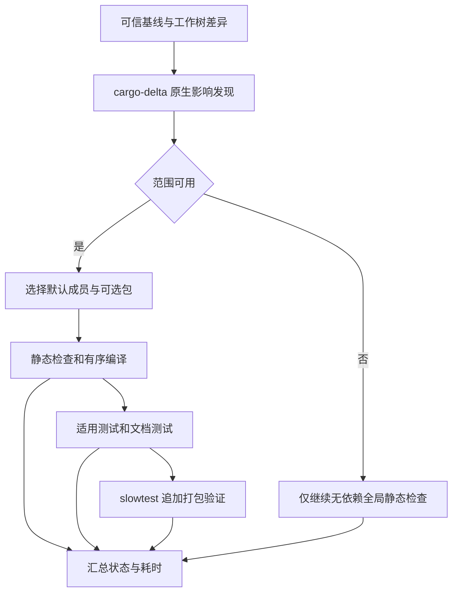

# 验证入口、影响选测与证据边界

本页帮助定位验证入口，不替代根 [AGENTS.md 第 3 节](../../AGENTS.md#3-构建与测试)及其 [3.3 验收矩阵](../../AGENTS.md#33-验收方法怎么测试怎么验收)。已批准的需求和具体验收条件以 `openspec/specs/` 为准。影响范围门通过只证明本次实际执行的所选范围；完整验收须按权威矩阵逐行取得证据，发布还须单独确认运行和产物。

纯文档任务默认只读核对内容、差异、引用与需求保留，不运行产品构建或测试，也不为文档补建功能测试。以下入口是操作指南，不是执行记录或授权。

## 先选权限和验证层

以下命令从仓库根目录的 Windows PowerShell 执行。产品功能修改根据行为、风险和批准的验收条件选择最小充分验证；跨模块或公开入口到可观察结果的要求，不能靠编译、纯逻辑或无崩溃断言代替。

```powershell
python scripts/test_gate.py fastcheck
python scripts/test_gate.py fulltest --authorized
python scripts/test_gate.py slowtest --authorized
```

- **fastcheck**：静态、类型、格式和编译检查，不运行测试；通过不证明功能验收。
- **fulltest**：在同类检查之外执行选中范围适用的 Windows 非打包产品测试、文档测试和真实依赖验证。全过程离线，子进程设置 `CARGO_NET_OFFLINE=true`，结束后恢复原环境；本机 loopback、命名管道及本地 bare Git 仍可使用。不查询最新发布、不下载或安装工具和资产，不生成交付包。
- **slowtest**：执行一次相同的受影响功能覆盖，另按适用范围进行真实外网、官方最新发布查询和在线准备，以及 release 全目标构建、完整本地打包和双产物校验；不先运行 fulltest 再重复功能测试。三级门均不证明在线供应链漏洞审计通过。

fulltest 和 slowtest **各次均需用户当次明确授权**；`--authorized` 是声明而非授权来源。真实桌面驱动、占用焦点或鼠标、全局热键探测及发布有独立的当次授权边界；门不会触发这些操作、CI 或远程流水线。尤其不能仅为满足矩阵自动启动桌面测试；抢鼠标流程还须用户当次明确要求使用 [e2e.md](../../e2e.md)。必要重跑不得静默重跑到绿。

fulltest 对真实 Xberg 使用固定本地测试引擎目录 `C:\Users\jiang\Documents\xberg-test\xberg-cli-x86_64-pc-windows-msvc`，离线核验来源、摘要、模型、运行时与协议；真实 7-Zip 和媒体夹具也要具备适用前置。缺失或不兼容应报告路径和 FAIL / UNVERIFIED，不能联网补齐后冒称离线通过。slowtest 的在线准备不等于授权独立最新发布对照或发布。共享引擎架构见 [共享 Xberg](../integrations/shared-xberg.md)。

## 影响发现到汇总



图：影响发现决定选包，门级决定后续阶段；失败仍汇总可运行阶段，桌面验收不在图中的门内。

[`cargo_delta.py`](../../scripts/cargo_delta.py) 从 `cargo metadata` 枚举成员及特性，使用上游 `cargo-delta 0.5.0` 相对 `origin/main` 做原生文件发现和依赖图选包。它考虑已提交、暂存、未暂存、删除和未忽略的未跟踪差异；安装是独立显式操作 `python scripts/cargo_delta.py --install`，fulltest 不自动安装。报告应包含基线、选中与排除的包、扩大原因及已知缺口。

这是尽力分析，不是自定义文件归属表：根外动态输入、生成代码、UI、资源或脚本的关联可能漏掉。未选中不证明行为已测；指出具体盲点，不承诺精确到单用例。选中 crate 执行全部适用测试。纯说明文档可能合法得到零包，此时报告无相关 Cargo 测试，而不是测试 PASS。原生确认全工作区受影响或独立完整验收才全量；工具缺失、基线不可信、元数据或分析失败时，报告 FAIL / UNVERIFIED，仅继续无依赖全局静态检查，不自动退化成未经裁剪的全量产品测试。

[`local_gate_plan.py`](../../scripts/local_gate_plan.py) 将选中默认成员和两个 optional 包分开编排；全局或无法安全局部化的检查保留。阶段顺序执行，高风险优先，编译生产者有序；失败后继续无依赖阶段和用例，缺前置的依赖项标明未运行，最终非零并汇总，不设硬时间阈值。每次运行由 [`gate_runtime.py`](../../scripts/gate_runtime.py) 分配带进程和唯一运行标识的独占日志目录，保留失败诊断及聚合状态、数量和耗时，不持久保存成功用例明细。勿复用或清空其他运行的证据。

## 测试入口与实际边界

根 workspace 默认成员包含根包及 13 个生产 crate，包括 jchocr，但**不包含** `snap-ocr-core` 和 `snap-ocr-worker` 两个 optional 包。完整基线需分别覆盖根和两个 optional 包的 nextest 与独立 doctest；具体手工命令、矩阵和权限以 [AGENTS.md 3.3](../../AGENTS.md#33-验收方法怎么测试怎么验收) 为准。不要用普通 `cargo test` 代替正式门。受影响组件的显式局部入口是诊断工具而非完整验收，例如 jchocr 的 `cargo test -p jchocr --features test-hooks --test jchocr`。

fulltest / slowtest 要求 nextest 0.9.116 或更新版本，共用 [nextest 配置](../../.config/nextest.toml)，禁用重试、非 fail-fast、无测试视为失败，默认过滤 `gui_flow`。门转发线程数为可用逻辑核数与 28 的较小值，至少 1；手工 nextest 须按 AGENTS 的 PowerShell 参数显式设置，配置中的 `num-cpus` 自身没有 28 上限。共享物理引擎测试使用单并发 `engine-session` 组，jchocr 三个容量边界用例使用独立单并发组，其余 CLI 测试可并行；这与 Cargo 编译 jobs 不同。

worker 使用 nextest 原生优先级让长生命周期用例先启动，但保留原有分组；真实共享引擎及后台控制仍单并发，原有 Job、会话锁、测试桌面、非交互 window station、注册表和进程隔离不变。匿名 station 按登录会话命名，并非每进程独享，因此剪贴板用例与名单外、新增用例仍在同一 `engine-session` 组内串行，防止序列号互扰。仅 [nextest 配置](../../.config/nextest.toml) 中逐名审核、精确列入白名单且不触碰这些共享资源的独立截图、协议、字体和本地状态用例可重叠执行；这不是选测过滤，不减少所选包的实际测试数量。

根 [`build.rs`](../../build.rs) 与 [`optional/snap-ocr-worker/build.rs`](../../optional/snap-ocr-worker/build.rs) 仅在 Windows 且启用 `test-hooks` 时，使用 Cargo 提供的 `RUSTC` 和 `TARGET`，将合成引擎夹具编译到 `OUT_DIR`，跟踪夹具源码及相关构建输入。测试仍复制到各自隔离根目录；Markdown 用例通过本轮目录的 `extract-response.json` 提供原有响应正文，不再为不同正文重复编译。生产构建不生成这些测试产物。复用的是构建产物，不是成功测试结果，全部适用用例仍实际重跑。

[`tests/common/process_probe.rs`](../../tests/common/process_probe.rs) 用一次原生进程快照及最小权限路径查询，判断是否可能存在原清场脚本可处理的测试引擎或 worker；仅用户 GUI 存活不再启动 PowerShell。任何枚举或路径查询不确定均保守进入原清场；最终所有权过滤、清理顺序和等待不变，用户进程存活与测试孤儿回收仍由现有真实子进程回归验证。

性能对照须固定执行范围、阶段、工具链、target、profile、features、Cargo jobs 和等价有效构建缓存，不拿首次重编与后续暖缓存比较。2026-11-07 在 Ryzen 9 9950X（32 逻辑核、约 46.9 GiB 内存）完成显式完整 18 包对照：Cargo jobs=16、nextest=28，每轮全部测试实际执行，保留真实 7-Zip、Xberg 存在性及媒体阶段；未执行独立桌面、ignored 模型和发布验收。基线已包含 worker 优化，根测试优化收益按此保守计算。

| 指标 | 基线 | 优化后 |
|---|---:|---:|
| fulltest 总墙钟（秒） | 346.708 | 227.186 |
| nextest 阶段合计（秒） | 294.988 | 194.828 |
| 实际通过 / 失败 / 原生跳过 | 1264 / 0 / 133 | 1264 / 0 / 133 |
| 同窗整机 CPU 均值（%） | 45.05 | 47.26 |
| 同窗整机内存均值（%） | 69.81 | 68.93 |

总墙钟降低 34.47%，nextest 阶段合计降低 33.95%；不是清空 Cargo 缓存后的冷构建提速。证据位于本轮 `.tmp/fulltest-perf-20261106/` 的 `full-baseline-measured.json`、`full-final-verification.json`、`comparison.json` 及各自 `stage-timings.json`；同窗负载取自 `D:\JchTools-performance.csv`，不持久保存成功用例明细。最初 worker 基线因已安装应用持有同会话 Xberg 失败；先正常停止空闲截图后台后重建基线，未杀用户引擎或削弱单实例约束。构建脚本的 Clippy / 格式错误修正后，完整门退出码为 0。

| 层次或入口 | 能证明的范围 | 不能外推的范围 |
|---|---|---|
| 纯逻辑 UT、编译与静态检查 | 被断言的局部逻辑或结构 | 真实依赖、完整产品链路和验收 |
| GUI 内 Slint TestingBackend | 真实回调和后端下的界面状态 | 真实窗口、焦点、鼠标及桌面布局 |
| [`tests/xberg_shared_process.rs`](../../tests/xberg_shared_process.rs) | 真实 JchTools 代理和命名管道上的复用及隔离 | 引擎由 `rustc` 编译的模拟替身提供，不证明真实模型常驻或桌面链路 |
| Git 测试和 GUI S16 | 真实 Git 与本地 bare 远端 | 真实网络、认证 |
| 真实 7-Zip、Xberg 或媒体用例 | 仅本次具备并核验的引擎、模型、运行时及断言 | 缺失资产、其他模型或桌面入口；引擎存在性检查不等于全部模型验收 |
| `gui_flow`、GUI smoke 和 Markdown 桌面验收 | 获授权后实际执行并断言的真实窗口链路 | 未执行阶段、其他 DPI 或环境、完整发布验收 |

`test-hooks` 仅供隔离测试，允许测试路径和代理覆盖，生产及打包构建不启用。无头 MCP 流程见 [e2e.md](../../e2e.md)，须成套隔离状态、凭据及测试注册表；它不占用真实桌面，也不替代真实窗口验收。GUI 架构见 [应用与 GUI](../architecture/application-and-gui.md)，文件安全风险见 [文件任务安全](../concepts/file-task-safety.md)。

## 独立验收与交付

完整功能验收使用权威矩阵，而非把上述各层测试清单相加当作自动通过。独立 PowerShell 入口为 `powershell -NoProfile -File .\scripts\acceptance.ps1`，可按矩阵选择 `-WithEngine`、`-WithPackage`；真实桌面另获授权后才声明 `-WithDesktopTests`。`-WithGuiSmoke -GuiData <目录>` 和 `-WithMarkdownAcceptance` 也要求桌面声明，参数不创造授权。默认未满足授权及资产前置的真实 worker 热键服务测试为 NOT RUN。

[`gui_smoke.py`](../../scripts/gui_smoke.py) 默认覆盖 S1–S4、S15、S16、S18；扩展阶段通过 `--stages` 选择。转 Markdown 的 [`markdown_acceptance.py`](../../scripts/markdown_acceptance.py) 可用 `--list` 查条目，默认 `common`，`full` 扩展矩阵；缺资产为 NOT RUN，必验项未执行包括被 `--only` 排除时退出码为 2，OPTIONAL 不计通过。截图及 CLI OCR 的具体边界见 [截图与 CLI OCR](../workflows/screenshot-and-cli-ocr.md)。

slowtest 的安装包和便携 ZIP 原内容校验不等于已发布，也不自动覆盖需要授权的干净目录真实桌面运行。CI 只编译、打包和发布，不运行测试或质量门；发布需另行授权并确认对应 run 最终成功及实际版本产物。参见 [构建与交付](../operations/build-and-delivery.md)。

## 证据与临时数据

报告区分已实现、通过、失败和未验证，记录本轮命令、环境（OS、rustc、真实或模拟引擎）、退出码、关键输出、范围和未运行项。测试源码、测试发现、[`requirement_coverage.py`](../../scripts/requirement_coverage.py) 生成的需求候选引用、Wiki 核对、历史门结果以及 CI 打包成功，均不是当前测试执行或功能验收证明。未取得命令、环境、退出码及结果证据的事项应标为未验证。

测试数据和中间产物放在 `.tmp/`，通过 `python scripts/make_tmp.py` 创建；普通手工数据用 `python scripts/make_tmp.py testdata`，其 `--git` 只用于验证带 `.git` 的拒绝行为。结束后只清理本会话自建子目录；确认没有并行会话使用时才可全量 `clean`。本页为源码和规则的只读整理，不声称已执行产品测试、真实依赖、桌面或交付验收。
