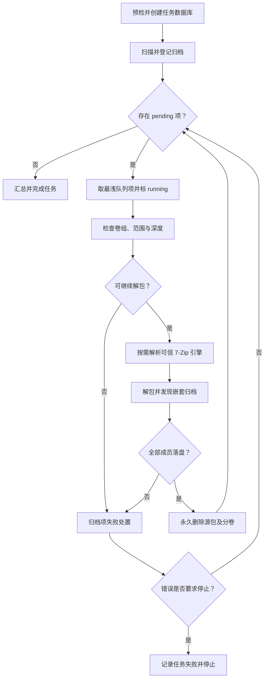

# 递归归档提取

递归解压是独立的文件任务，不是[目录整理](directory-organizer.md)的计划阶段：用户确认后，程序扫描选定目录并持续处理归档，不提供计划审核，也不生成整理计划。入口为 `extract_run`；GUI 在工作线程调用它，并把任务事件映射为完成事件。参见[文件任务](../concepts/file-tasks.md)了解共用的任务控制与状态模型。

## 从扫描到嵌套队列

`extract_run` 先解析受保护目录，再经根目录预检创建任务数据库和 `Job`，调用共用扫描器登记文件及待处理归档。扫描过滤遵循当前递归、隐藏/系统、排除规则及特殊目录边界；GUI 的确认计数使用同一范围口径。若没有 pending 归档，则写入提示“未做任何改动”。

`extract_queued` 从数据库按 `depth,id` 顺序逐项选取 `pending`，标为 `running` 后检查归档卷组、范围及最大嵌套深度。只有到达真实可解包项时才解析引擎；因此缺卷等纯文件系统预检不依赖 7-Zip。单包提取后，扫描新落盘成员并将发现的嵌套归档登记为更深层待办；队列每轮重新查询数据库，因此嵌套项也进入同一任务流程。深度达到 `max_depth` 会按失败处理，避免无限递归。

*图：任务队列逐包推进，成功包清理源文件；一般包级失败隔离后继续，取消、空间不足及源包清理错误等任务级条件停止处理。*

## 引擎发现与可信边界

默认解析器使用 `SevenZip::from_bundle()`。引擎候选按顺序为可执行文件旁的 `resources/7zip`、用户数据目录中已释放的内嵌副本（含独立 `release-*` 目录），最后才从 EXE 释放内嵌引擎。候选须满足适用清单列出的文件存在且 SHA-256 一致；无效候选不执行、不覆盖，并继续尝试下一项。内嵌构建使用 EXE 中清单，非内嵌构建只接受带 `manifest.json` 且校验通过的随包引擎。全部不可用时返回包含候选原因的错误并停止任务，不会静默跳过归档。GUI 路径没有显式注入引擎；`extract_run_at` 的显式路径参数属于测试注入接口。

## 处置、失败与持久化

每项归档状态在任务数据库中由 `pending` 变为 `running`，再进入 `done` 或 `failed`。完全解开的归档（成员均成功落盘）在成功结算前永久删除原归档及其实际分卷，删除使用 `Job::delete_path` 的审计与数据库语义，不受目录整理删除设置影响。不会回滚已落盘成员。

未完全解开（如成员被排除、目标冲突无法安置）时，源包保留并尝试移入“解压失败”隔离目录；普通解压错误（损坏、加密、不支持或触及防护上限）同样记录原因并隔离。隔离本身失败会记录失败与源项位置，通常仍可继续其他包。成功/失败计数及日志在结算时更新；完成计数代表已处理的包，不等同于成功数。

取消会在文件操作检查点生效；取消错误向上传播，不把它伪装成包损坏，也不触发隔离。空间不足和源包删除失败属于任务级中止：保留当前源项，不继续后续包。删除失败时解压结果可能已完整落盘，当前卷可能已删除，后续卷不再尝试，已删卷不回滚，也不隔离部分删除的卷组。任务级错误由外层记录任务失败；正常结束时持久化汇总并将任务状态设为 `finished`。详见[构建与诊断](../operations/build-and-diagnostics.md)。

<!-- openwiki: broken internal link [../../tests/archive] file "../../tests/archive" does not exist. Fix the href or restore the target, then delete this comment. -->
GUI 在启动后台任务前启动任务观察器，用新建任务目录与失败列表关联运行中的失败记录；界面明确告知成功后原包不可恢复、失败包保留并隔离。实现变更时重点保持队列状态转换、源包删除与结算顺序一致；代表性回归覆盖见 [`tests/archive`](../../tests/archive)、[`tests/archive.rs`](../../tests/archive.rs)，包括提取流程、卷组清理、冲突审阅及语义回归。
