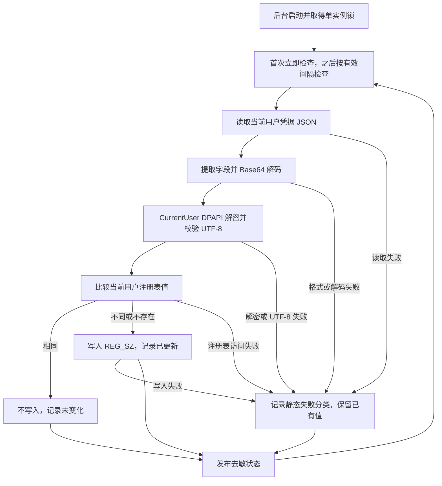

# CodeAgent 本地 Token 自动维护

CodeAgent 是独立的 Windows 本地凭据维护后台，不是 Xberg 代理：它不负责代理请求，也不需要联网或调用 PowerShell。打开 GUI 的 CodeAgent 页面会请求启动或连接后台；后台使用独立进程，关闭 GUI 不会停止它。有关应用入口与界面框架见[应用与 GUI](../architecture/application-and-gui.md)。

## 检查与安全边界

图：定时检查只在值变化时写注册表，失败以去敏状态报告并在后续周期重试。

生产路径是 `%USERPROFILE%\.cac\.credentials.json`，读取 JSON 的 `idaasOAuth.xAuthToken`，通过 `CryptStringToBinaryW` 解码，再以无附加熵、禁止交互的 `CryptUnprotectData` 使用 CurrentUser DPAPI 解密，严格按 UTF-8 解析。DPAPI 分配的明文缓冲区在释放前清零；这不意味着所有后续字符串副本都被保证清零。

解密成功后才打开或创建 `HKCU\Environment`，目标值为 `JCH_CODEAGENT3_X_AUTH_TOKEN`。已有 `REG_SZ` 与包含终止符的 UTF-16 值一致时返回 `Unchanged` 而不写入；否则写入 `REG_SZ` 并返回 `Updated`。空字符串或内含 NUL 被拒绝。读取、格式、解密、UTF-8 或注册表访问失败不主动清除已有值；读取或解密失败甚至不会创建目标键。

凭据不进入 SQLite、GUI 或日志；可传播的检查结果仅为 `Waiting`、`Updated`、`Unchanged`、`ReadFailed`、`DecodeFailed`、`DecryptFailed`、`InvalidUtf8`、`RegistryFailed` 这些静态分类，不传播解析器错误正文。SQLite 保存间隔和去敏状态，状态包括运行标志、PID、有效间隔、最近检查时间和结果；日志使用静态事件与分类。注册表本身是明文目标，应避免在诊断中展示其内容。

## 进程、间隔与观察

`src/main.rs` 将内部 `--codeagent-service` 分派给 `serve()`，与 `--xberg-broker` 分支分开。GUI 的 `ensure_started()` 先观察锁，必要时以无窗口、脱离父进程的方式启动当前可执行文件，再有限等待可观察的运行状态和 PID。真正的单实例裁决在后台独占持有的 `codeagent-service.lock`，重复启动在锁争用时正常退出；锁一直持有到进程实际结束，包括日志刷盘。运行状态以锁探测为准，而不是盲信 SQLite 中可能过期的 `running` 或 PID。

默认间隔为 60 秒；GUI 保存的 `codeagent_interval_seconds` 必须是正整数秒，存入共享 `app_settings`。后台每秒重新读取配置，以自上次检查经过的时间决定是否到期，因此改变间隔无需重启，也不会每秒重复解密。后台使用零等待 SQLite 连接：首次读取失败暂用 60 秒，此后读取失败保留上次有效间隔；状态发布失败不停止检查或释放锁，恢复后重试发布最新去敏状态。启动请求可能因读不到状态而报错，即使独立后台已经启动并继续维护。

GUI 的观察线程处理启动和保存请求，并约每 500 毫秒刷新状态；展示运行情况、PID、最近检查、结果和后台有效间隔。已保存间隔与后台当前有效间隔分开读取，编辑中的草稿不会被刷新覆盖；保存失败单独显示，不停止后台。状态读取失败显示状态未知，不应据此断定后台已经退出。更多共享状态和诊断背景见[状态与诊断](../operations/state-and-diagnostics.md)。

## 安装与卸载的维护退出

普通窗口关闭不发送停止请求。安装升级替换文件之前、确认卸载删除文件之前，安装器调用内部 `--codeagent-service --stop`；它不是普通用户操作入口。控制锁串行化启动清理与停止请求，防止握手丢失。停止方不依赖 SQLite，也不强杀进程：读取持锁后台发布的 PID，发送停止文件，请求自然退出，等待进程句柄及单实例锁释放；等待失败返回错误。后台检查到请求后尽力发布停止状态，但不会等待数据库可写。

升级时安装器使用本次安装包携带的临时维护控制器，不运行可能忽略停止参数的旧版程序；卸载时使用已安装的程序。控制器失败会阻止替换或卸载，而不是声称成功；该协议不删除源凭据或已有注册表 Token。安装交付背景见[构建与交付](../operations/build-and-delivery.md)。

## 验证范围与隔离

Windows 测试使用合成数据和真实 CurrentUser DPAPI，断言解密、隔离注册表的 `REG_SZ` 更新与未变化结果，以及错误密文、无效 UTF-8、无效 JSON 和读取失败时保留旧值。测试还覆盖间隔校验、单实例、短命启动宿主退出后后台继续、SQLite 独占争用期间继续检查及恢复、状态和日志不含所用合成值。争用测试通过锁和注册表变化观察后台，而不是依赖受争用阻塞的状态读取。

`test-hooks` 隔离要求同时配置绝对路径 `JCHTOOLS_TEST_CODEAGENT_CREDENTIALS`、绝对路径 `JCHTOOLS_TEST_STATE_DIR` 和位于 `Software\JchTools\Tests\CodeAgent\` 下的 `JCHTOOLS_TEST_CODEAGENT_REGISTRY`；部分配置或无效注册表变量会拒绝回退真实位置。相关回归还覆盖保存与生效间隔的区别、维护退出及安装升级和卸载入口。上述是测试代码的断言范围，不等同于本次已执行测试或真实桌面验收；参见[验证](../testing/verification.md)。
