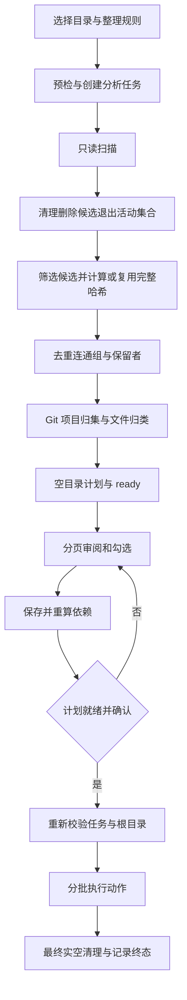

# 目录整理：只读分析到确认执行

目录整理是两段式任务：`engine::prepare` 分析并写入任务数据库，用户检查计划后才由 `engine::apply` 执行。分析对用户目录只读，不解压也不移动或删除文件；已有压缩包作为普通文件处理。任务库、日志和哈希缓存则会写入状态目录。需要解压时使用独立的[递归解压](recursive-extraction.md)，不要把两个工具的安全语义混为一谈。

图：从只读分析到确认执行的主要路径；失败或取消可以在各阶段中断。

## 分析与计划

1. 预检根目录与保护范围，创建 `analyzing` 任务并扫描。先在事务中识别清理项：各清理规则分别决定是否请求永久删除，任一命中规则请求删除就产生一条删除动作并从活动候选中停用；选择保留的规则不会否决其他规则。这样待清理文件不会成为去重的唯一保留者。
2. 若启用去重，按大小和所选名称关系筛选可能匹配的活动文件，计算整文件哈希，没有预哈希与完整哈希两遍流程。`hash_workers` 控制并行度；跨任务缓存以可靠文件标识、大小和修改时间复用结果，缓存故障降级重算。单个文件哈希失败会记错、停用并记录跳过，取消则不把整批取消项算作错误。
3. 去重先按大小及启用的同名、副本名或不同名关系构建连通组，再在组内按完整哈希分组，按保留策略稳定选出保留者。副本名关系具有传递性；哈希失败的空哈希节点可作为关系桥，但不能成为保留者或删除对象。启用不同名规则时，所有同尺寸项进入候选关系。可靠识别出的既有硬链接不当作独立副本删除；全局选择保留时不生成副本删除动作。
4. 计划器接着规划 Git 项目整体归集、普通文件归类和空目录清理，顺序很重要：项目移动可释放后续目标路径。冲突通过来源前缀、必要时短哈希和截短等确定性命名消解。动作记录包含来源、目标、原因、选择和状态；成功完成分析后摘要与状态写为 `ready`，等待确认，而不是自动执行。

有关实现入口与规则可从 [engine.rs](../../crates/directory-organizer/src/engine.rs)、[planner.rs](../../crates/directory-organizer/src/planner.rs) 和 [dedup_components.rs](../../crates/directory-organizer/src/dedup_components.rs) 开始。修改清理、哈希筛选或名称关系时，必须同时考虑候选退出顺序和连通组的桥接语义。

## 审阅、重算与就绪门禁

GUI 后台 worker 在同一个只读事务中读取计划页与就绪快照，每次请求最多取 101 行，用于显示 100 行及判断下一页。页面和状态快照各有代际；过期页面或不匹配当前筛选的结果不能覆盖视图。第一页加载失败清空页面并按不可执行处理，避免旧任务或旧筛选的行冒充当前计划。

取消勾选不是简单隐藏行。`recompute_plan` 只使用已有分析数据，要求任务仍为 `ready`，不重读文件内容，也不自动新增勾选。未选且待执行的移动、删除和空目录项原位置视为占用；如果另一移动的目标被占用，就取消它并继续传播到固定点。被保留项阻挡的空目录清理也取消；原地保留的 Git 根及其相关目录受到保护。执行时仍要独立复查目录是否实空。

就绪快照要求任务 `ready`，当前目录规范化后与记录根一致，当前规则与任务配置一致（外观 `theme` 除外）。规则或目录改变需重新分析；任务已结束或库不可读不能执行。即使快照就绪，页面加载、勾选保存或依赖重算在途、重算失败、启用的数字输入无效时也不放行；`start_task` 在启动时再次检查这些条件。页面、勾选与失败状态的界面实现见 [plan.rs](../../crates/gui/src/gui/plan.rs) 和 [task_flow.rs](../../crates/gui/src/gui/task_flow.rs)。

## 执行边界与可观察结果

`apply` 先确认 `task.sqlite3` 已存在，再开库、获取全局锁、检查状态为 `ready`，重新规范化根路径并验证其与记录一致，再校验配置。锁目录优先使用任务记录；记录不可用时仅允许从合法的 `tasks/<任务>` 布局推导。旧任务不是 `ready` 或根被移动、替换为链接时拒绝盲目重放。

执行按最多 64 条动作分页，以 SQLite 事务批量记录；连续文件删除和同深度空目录删除可并行，移动按依赖排序：例如 `a → b`、`b → c` 先释放 `b`，交换环则在源旁独占暂存。Git 根只有成功移动后才解除保护；失败后的独立动作仍可继续。暂存恢复失败时日志给出路径，非空暂存不会被递归删除。未勾选项记为未选择；空目录在删除前复查，不存在、类型改变或非空则跳过。正常执行动作后还会做最终实空清理；非递归模式对原有后代有范围限制。

**数据库事务不回滚文件系统。** 出错或取消时执行批次尽力提交已完成的记录，避免磁盘已变更而任务库失去对应状态；强杀或崩溃仍可能丢失当前未提交批次的状态与审计记录，不能依赖断点恢复。执行期假定其他程序不改动处理中的文件，不重新比较文件快照，也不重新读取内容验证去重；操作前应避免并发修改。永久删除不可恢复，详见[文件任务安全](../concepts/file-task-safety.md)。

执行阶段逐行记录 `done`、`skipped`、`failed` 或未选择，并更新日志和摘要。取消优先记为 `cancelled`，未完成的取消项可仍为 `pending`；非取消的动作失败增加错误数，执行期新增错误使任务终态为 `failed`，只有无新增错误且流程成功才为 `finished`。分析期已有错误不自动使成功执行变为失败。失败或取消后应查看计划行、摘要和日志，不要把部分执行当作回滚；再次整理需重新分析。

## 具体测试依据

以下是源码中的断言范围，不表示此处已运行验收：

- [dedup_components.rs](../../crates/directory-organizer/src/dedup_components.rs) 的测试断言空哈希副本名节点能连接其他记录，但不出现在删除组；仅开启副本名时两个完全同名记录不会自行成组。
- [classify_shape.rs](../../tests/classify_shape.rs) 断言归类后文件直接位于一级大类、冲突文件按来源或短哈希区分，Git 项目内容保留在集合中；再次分析的移动、删除、Git 和空目录计划数均为零。
- [tests_plan_pages.rs](../../crates/gui/src/gui/tests_plan_pages.rs) 断言旧代际或不匹配筛选的页面被拒绝；130 行夹具第一页显示 100 行、第二页 30 行，筛选移动后只显示 10 行。失败收尾测试断言摘要重新加载为三个计划删除项。

更广泛的测试入口与验证边界见[验证](../testing/verification.md)，GUI 状态所有权见[应用与 GUI 架构](../architecture/application-and-gui.md)。
