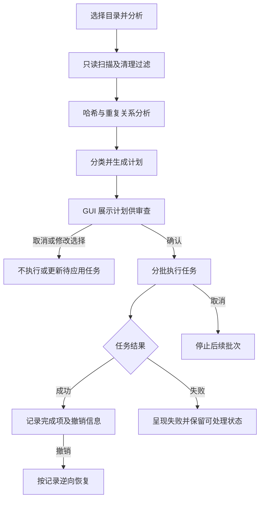

# 目录分析、审查与执行

目录整理器将发现问题与修改文件分为两个阶段：引擎先读取文件并产生可审查的任务计划，用户确认后由 GUI 按批次执行。计划本身不是事务；应用阶段对已执行的操作提供回滚路径，但不能保证外部文件系统变化下的全局原子性。

## 流程概览

图 1：从目录分析到计划审查、分批应用以及取消或撤销的主要路径。

## 分析与计划

分析阶段的职责是枚举目标内容、评估清理候选并构建后续任务，不应把“分析”误认为已经移动或删除文件。清理过滤相关行为由引擎处理；哈希及去重组件将文件内容相同的关系组织为图结构，因此重复项不是简单地按文件名比较。分类结果再由 planner 转为 GUI 可呈现的计划。

计划审查是安全边界的重要部分：用户在实际修改发生前查看拟执行操作，并可选择不继续。计划层与执行层分离，使分类或去重逻辑能够输出建议，而不直接承担破坏性操作。

## 执行、取消与恢复

GUI 计划界面负责驱动待执行任务的批次，而非一次性无条件提交整个目录。执行成功的操作需要保留足以支持恢复的记录；发生错误时，已经完成的操作与尚未运行的操作不能视作同一状态。取消意味着停止后续工作，不应据此推断已完成的文件系统操作自动回滚。用户需要显式使用撤销能力恢复已执行部分。

文件系统不是封闭事务环境：目录在分析与应用之间可能变化，目标路径也可能发生冲突。因此使用者应在审查时确认计划，并将错误与部分完成视为可能结果；避免把界面上的取消等同于原子回滚。

## 测试关注点

`tests/engine_cleanup_filter.rs` 覆盖清理阶段的过滤行为；`tests/dedup_graph.rs` 检验重复关系图；`tests/gui_flow.rs` 关注 GUI 中计划流程的集成行为。修改清理条件、重复关联规则或执行生命周期时，应分别运行相关测试，确认分析结果、计划呈现和执行路径之间仍一致。

## 相关主题

- [应用架构](../architecture/application.md)
- [文件任务](../concepts/file-tasks.md)
- [归档提取](./archive-extraction.md)
