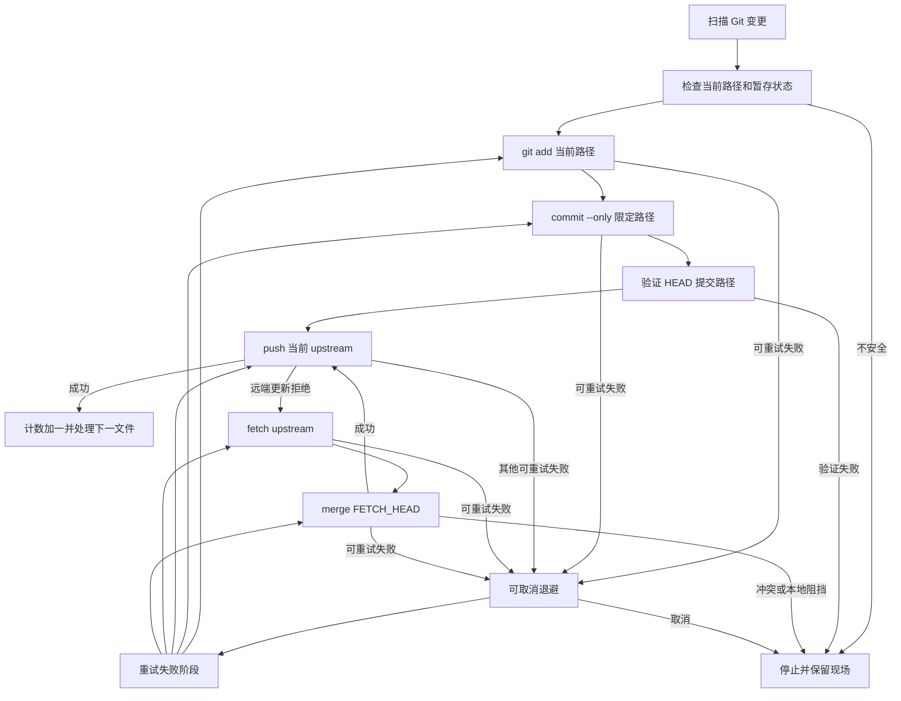

# Git 逐文件提交推送与停止恢复

Git 工具是一个受限的发布工作流，不是通用 Git 客户端。GUI 接受仓库目录，在后台创建 `Control` 和 `GitShared`，查找系统 `PATH` 中绝对目录里的 `git.exe`，然后调用 `git_tools::run`；不提供分支管理、clone 或 rebase 界面。实际 Git 命令不经 shell，继承用户配置和环境，均带 `--literal-pathspecs`，避免文件名被解释为通配 pathspec。选择仓库子目录也可以，验证后从仓库根执行，保护检查因此覆盖全仓库。

## 启动和目标边界

启动要求目录有效、仓库有检出分支且配置 upstream；detached HEAD 或缺失 upstream 会停止。远端与分支分别从 `branch.<b>.remote` 和 `branch.<b>.merge` 读取，而不是拆分显示名，因此支持带斜杠的分支和本地 upstream `.`。工具不自动切换分支或修改 remote。

任何写操作前，目标预检核对裸 push 实际使用的 remote 与 upstream 一致，拒绝自定义 `remote.<r>.push`、mirror、多分支 `push.default=matching`、`nothing` 和不受支持的值；`simple` 或 `current` 在本地与 upstream 分支不同名时也会拒绝。Git 展开 URL 改写后，所有 push URL 必须与 upstream 的 fetch URL 一致，本地 upstream `.` 例外。这是当前实现对 [G 规格](../../openspec/specs/git-file-publishing/spec.md) 和 P-03 网络范围的具体防护，不是对任意 Git 配置或网络访问的普遍授权。push 和 fetch 均禁止递归子模块。

## 串行发布

扫描使用 `git status --porcelain=v1 -z --untracked-files=all`，以 Git 状态而非深度遍历作为待处理清单；输出不完整会拒绝处理。新增、修改、删除各为一个逻辑变更，Git 识别的 rename 则把新旧路径作为一次变更。提交信息为 `update: <相对路径>`，rename 使用新路径。

图：单文件处理及阶段记忆；图中的重试分支只回到实际失败的阶段，只有 push 成功才进入下一文件。

`git add --` 限定当前暂存路径，`git commit --only -m ... --` 限定提交路径，不把其他已 staged 文件带入当前提交。rename 暂存新路径，提交和验证包含新旧路径。完全预暂存的删除若 add 因 pathspec 失败，核实索引与工作区的删除状态后可直接提交。提交后用 `diff-tree` 比较 HEAD 实际路径与预期路径，不符立即停止，不继续 push。commit 非零也可能在提交已发生后出现：实现检查真实路径状态，再执行范围验证，而不是依赖本地化的错误文字。

## 保护、合并与恢复

处理前检查当前路径的 index/worktree 部分暂存分叉，包括已暂存删除后重建同名文件；若继续 add 会覆盖用户 staged 版本，则不写索引并停止。删除路径被目录替换，以及子模块 HEAD 未变但仅有内部脏内容等无法安全由父仓库提交的结构，也会在 add 前拒绝。工具不通过 reset、checkout 或 clean 清除用户内容。

push 使用 `git push --porcelain --no-recurse-submodules`，没有附加远端或分支参数。实现将 `fetch first`、`non-fast-forward`、`stale info` 分类为需要合并，执行指定 upstream 的 `git fetch --no-recurse-submodules`，再 `git merge FETCH_HEAD`，不擅自 rebase。fetch 成功后 merge 可重试时不会重复 fetch；合并成功仍需重新 push。其他 push 失败，包括网络或认证失败，按可重试处理，并不自动改为直连。

合并前对远端实际影响的 `assume-unchanged` / `skip-worktree` 路径检查隐藏的本地内容，尊重过滤器和 EOL，若存在覆盖风险则停止且保留标记。普通脏内容由真实 merge 判断；若阻挡合并则停止。merge 后先检查未合并索引，即使 Git 返回成功也不能忽略 autostash 恢复冲突。冲突时保留现场，不替用户选择 ours 或 theirs；其他未完成的 rebase、cherry-pick 或 revert 也阻止自动发布。

重新启动以 Git 当前状态为准重新扫描，不为进度建立永久数据库。未解决的 merge 继续停止；用户解决并暂存后，工具检查全仓库暂存内容是否超出合并范围，安全时执行 `git commit --no-edit`，先推送合并提交，再扫描剩余变更。已成功提交并推送、且不再显示为未提交的文件不会重做。工作区干净时比较 HEAD 与**本地已知** upstream：本地领先则只补推，不重复 commit；仅落后则不自动拉取；零差异也不能证明真实远端当前一致，因为该检查不 fetch。

## 停止、退避和可观察性

可重试失败无限重试当前阶段，生产等待依次为 5、10、20、40、80 秒，之后保持 80 秒；等待以约 100 毫秒粒度检查取消并刷新倒计时。停止不强杀正在执行的 Git、hook 或 filter，而是在命令自然结束后不启动下一阶段、下一次重试或新文件，也不回滚已成功的提交。停止可能留下已暂存内容、未推送的本地提交或合并现场，重新启动按实际状态续接。

`GitShared` 由 worker 更新、GUI 轮询，包含仓库、分支、upstream、当前文件、阶段、重试次数和等待、总数及已完成数；只有 commit 加 push 成功才增加完成数。新任务开始清空上一仓库的显示。日志回调记录实际 Git stdout/stderr、错误、重试和成功信息，单条输出有长度限制；状态和阶段使失败、冲突与停止可区分。参见[应用与 GUI](../architecture/application-and-gui.md)及[状态与诊断](../operations/state-and-diagnostics.md)。

## 配置与代理

系统 Git 的身份、认证助手、SSH、签名、hooks、filters 和合并策略由用户原有配置与环境决定。对 fetch/push，G-17 允许在 HTTP(S) 目标需要时，按 Windows 当前用户手动系统代理和目标例外表，给该子进程补充缺省的协议代理环境变量；已有协议或 `all_proxy` 环境变量时不补充，Git/libcurl 自身处理显式 Git 代理、空值及 `NO_PROXY` 优先级。非 HTTP(S) 和本地 upstream 不补充；不修改持久 Git 配置或宿主环境。PAC/WPAD 不在规格范围内，代理失败也不降低 TLS 校验或扩大 upstream 网络边界。

## 验证范围

[集成测试入口](../../tests/git_tools.rs)用真实 Git 和本地 bare 远端构造仓库，注入毫秒级退避；配套测试覆盖单文件提交、暂存保护、推送目标配置、fetch/merge、停止及子模块边界。它们验证本地 Git 行为，**不覆盖真实网络、远端认证或真实代理连通性**；不能由 bare 测试成功推断生产网络可用。更多测试组织见[验证](../testing/verification.md)。
