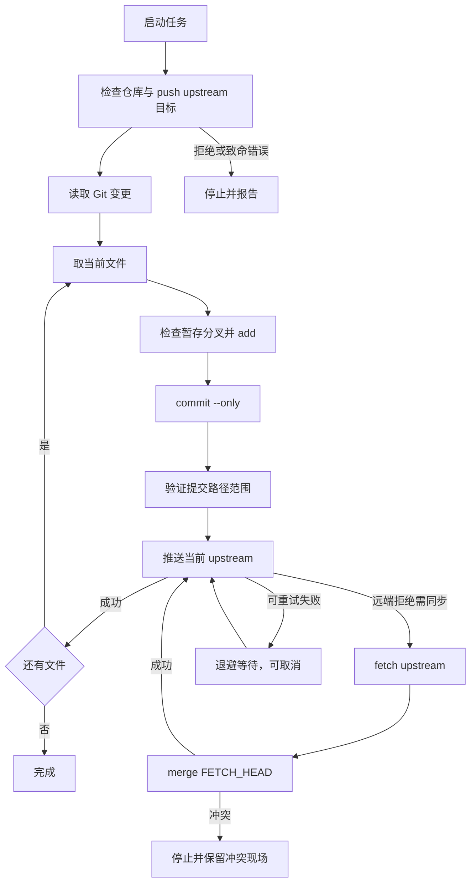

# Git 逐文件提交与推送

该工具将工作区变更拆成逐个文件的提交和推送任务，而不是一次性提交整个仓库。主入口 `git_tools::run` 接受 Git 可执行文件、仓库路径、`Control`、共享任务状态以及日志/状态回调；即使传入路径位于仓库子目录，操作也会以仓库根为准。GUI 在后台工作线程调用该逻辑，并通过回调更新界面状态。相关应用运行时参见[应用架构](../architecture/application.md)，服务与设置参见[设置与服务](../operations/settings-and-services.md)。

## 生命周期与顺序

启动阶段先检查仓库状态、当前分支及 upstream，并在任何写操作前验证裸 `git push` 的目标是否仍是当前 upstream：包括有效远端、push refspec、mirror、展开后的 fetch/push URL 以及 `push.default` 对目标分支的影响。不能安全保证只访问 upstream 的配置会拒绝启动，而不是冒险推送。随后从 Git 状态取得待处理变更清单；该清单不是 GUI 进度的替代品，Git 仓库状态才是进度事实来源。

每项变更按 `add → commit --only → 验证 HEAD 提交路径 → push` 严格串行处理。提交信息为 `update: <路径>`。验证确保本次 HEAD 提交仅含预期路径；当前文件 push 成功之后才进入下一文件。工具不会对本地领先提交盲目重复 commit：无工作区变更的收尾会比较 HEAD 与本地缓存的 upstream 引用，若本地领先则只补推；该比较不 fetch，因此不能证明远端当前状态。

图示任务级串行推送、远端拒绝后的 fetch/merge 重试，以及冲突和一般可重试失败的不同出口；取消会在命令边界或等待阶段阻止后续操作。

## 暂存区保护与安全边界

逐文件提交使用带 pathspec 的 `git commit --only`，避免把其他已暂存文件带入该提交。处理单文件前检查部分暂存分叉：若索引和工作区对同一路径各有不同内容，工具不执行 add，而是停止该文件，保护用户已暂存版本。已完全暂存的删除会识别并跳过必然失败的 `git add`，直接进入提交。

结构预检会拒绝不适合安全逐文件提交的状态，例如删除路径被目录替换、仅有子模块内部变更但 gitlink 未变。合并提交与普通文件提交不同，Git merge 可能把索引中其他内容一并带入，因此完成 merge commit 前会检查暂存路径是否完全落在合并变更范围内；范围外 staged 文件会导致停止，要求用户先自行处理。对带有 `assume-unchanged`/`skip-worktree` 标记的隐藏索引路径，合并前还会针对远端将影响的路径做保护性检查，避免覆盖未被普通 status 揭示的本地内容。

## Push 重试、合并与冲突

push 只针对当前分支 upstream。遇到需要同步的拒绝时，工具先 fetch upstream，再执行 `git merge FETCH_HEAD`，不 rebase；两者是分开的阶段，成功 fetch 会被记忆，后续 merge 可重试时不会重复 fetch。合并策略遵循用户 Git 配置。冲突通过未合并索引路径确认，不依赖本地化诊断文字；冲突停止任务并保留仓库中间态，供用户解决后重新运行。被本地未提交内容阻挡或无法安全检查现场时也会停止，避免重复修改仓库。

可重试失败采用以 `BACKOFF_UNIT` 为基准的指数退避，生产序列为 5、10、20、40、80 秒并封顶 80 秒，持续重试直到成功或用户停止。取消不会强行中断已经启动的 Git 命令，而是在命令结束后的边界检查停止标记，避免再启动后续命令；等待也可被取消。提交前取消可能留下已 add 的索引状态，commit 后、push 前取消则留下本地提交；再次运行时 Git 状态与 ahead/behind 收尾机制负责识别和补推，而不是假定上次进度。

## 可观察性与测试

GUI 通过 `GitShared` 暴露阶段、计数和状态，日志回调记录各 Git 阶段的实际输出；失败诊断不会只依赖英文或本地化的 stderr 文案。任务完成、取消、冲突和失败分别作为不同结果上报。

`tests/git_tools.rs` 使用本地 bare 仓库模拟 upstream，并注入毫秒级退避，避免测试真实等待。测试按主题拆分覆盖基础逐文件提交、fetch/merge、推送配置预检、暂存保护、停止控制、子模块边界及回归修复；修改流程时应优先扩展相应主题测试，并用全套 Git 集成测试验证实际 Git 行为。详见[验证与测试](../testing/validation.md)。
