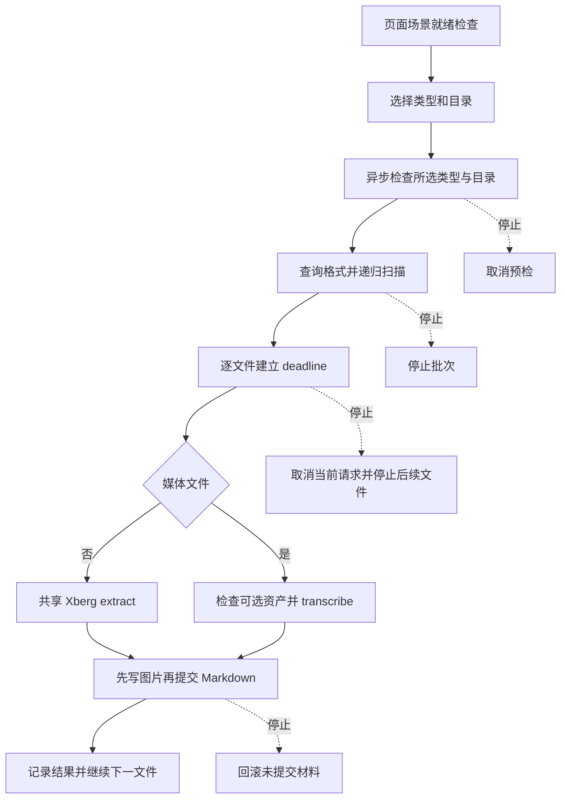

# 转 Markdown：扫描、推理与产物提交

转 Markdown 的公开入口是 GUI，Rust 库负责批次编排，文档、图片和媒体请求都交给会话共享的 Xberg，而不是为每个批次创建独立引擎。批次不拥有引擎生命周期，结束或停止后共享引擎及已加载模型仍可复用。共享进程的协调边界见[共享 Xberg](../integrations/shared-xberg.md)；转换后的整理是[另一工作流](markdown-organization.md)。

图：从 GUI 就绪、扫描和逐文件推理到产物提交及取消的主要边界。

## 就绪不是单一布尔值

`page_readiness` 的场景门槛是文档或媒体任一就绪；这不代表任意选择都可以运行。GUI 对当前勾选的 Pdf、Office、Images、Media、Other 异步执行 `readiness_for_groups`，开始前再检查目录和所选分组，`run` 也再次预检。后台结果带代次，避免旧检查覆盖新选择；检查和转换不占用 UI 线程。超时必须是系统可表示的正整数秒，至少选择一组，输入和输出必须是不同的现有目录。

精确预检有意保留一个重要例外：包含非媒体分组时检查文档资产；纯媒体时检查共享引擎基础资产，**可选音频资产在每个媒体文件转录边界检查**。因此混合批次缺音频不会阻断文档处理，媒体文件会明确失败并提示在设置页主动下载，不会自动联网。文档检查包含运行目录成员和许可证 notice；共享目录保存在应用设置中，运行时成员检查允许用户替换引擎，不以发布摘要锁死本地版本。文档与截图使用各自场景所需模型，不能把截图模型就绪当作文档模型就绪；媒体也有独立的 SenseVoice、VAD、FFmpeg 等资产需求。平台预检要求 Windows 11 x64 和 AVX2。

## 格式发现与扫描计划

非纯媒体批次先向当前共享引擎发 `formats`，限时 15 秒，验证响应及必需的 pdf、docx、pptx、xlsx，再按扩展名和 MIME 分组筛选；这使替换后的引擎能力成为实际来源。媒体只纳入固定的 mp4、m4a，纯媒体不依赖文档格式查询。其他音视频 MIME 不会借 Other 进入批次。

扫描递归遍历输入，不跟随符号链接或 junction；输入、输出路径本身也逐段检查链接和上级跳转。只有输出位于输入子树时才排除整个输出子树，避免把产物再次当输入。匹配的相对路径先稳定排序，再规划目标：`报告.PDF` 变为 `报告_pdf.md`；层级模式保留相对父目录，平铺模式统一放在输出根。同一目标按 Windows 忽略大小写规则判重，排序靠前者保留，其余记为 `skipped_duplicate`；已有目标记为 `skipped_existing`，均不覆盖。

文档图片目录根据产物主干生成 `_media` 名称，空白折叠成下划线；已有普通项或本批已分配名称冲突时加序号，链接则拒绝。扫描期单文件输出规划错误计失败并继续，遍历目录等全局错误则中止批次。总数包含待转换、两种跳过和扫描失败，后续文件序号与这个总数一致。

## 推理、deadline 与结果

每个文件开始时建立一个 deadline，推理请求使用剩余时间，图片写入和 Markdown 最终提交前也检查同一预算；格式查询和扫描不消耗这个单文件预算。文档和图片使用只含 `command`、`path` 的 `extract` 请求：页数自动分流、嵌入内容合并和 Markdown 规范化由引擎负责。适配器读取 `document.content`，收集图片字节、改写正文图片引用并传递警告，而不重复实现引擎转换。媒体请求 `transcribe`，要求有效 UTF-8 路径和非空 `markdown` 响应。

- `success`：产物已提交且没有警告；`partial`：产物已提交但有警告，例如部分内容未提取。二者分别计数。
- `failed`：扫描规划、推理、超时、协议或写入失败；普通单文件失败不阻断后续文件。
- `skipped_existing` 与 `skipped_duplicate` 分别表示既有结果和批内命名冲突，不是转换失败。
- `stopped` 表示收到停止请求。只有取消标志和明确的取消确认同时成立，当前文件才以取消事件而非失败呈现；取消接口失败或其他真实错误仍保留诊断。

停止可发生在预检、格式查询、扫描、当前请求或写入期间。当前请求按请求取消，不关闭共享引擎，也不取消其他场景的任务；不再启动后续文件。**已经提交的成品保留，包括媒体转换此前完成的文件**，当前未提交材料才回滚。停止标志本身不是引擎已结束的证明。

## 提交与保护

写入前重新检查目标不存在，逐段确认输出目录为普通目录。图片使用新建语义先写并同步，Markdown 先写到同目录临时文件并同步，最后用不覆盖改名提交；可见的 Markdown 因而代表本次图片材料已完整写入。失败、超时或取消时尽力删除临时文件和本次新建图片及空媒体目录，不触碰原有文件；清理失败会记录日志。最终改名仍防范扫描之后目标被占用，但目录检查不承诺抵御处理期间外部替换所有路径的竞争。

## 验证与操作边界

仓库中的 [转换门控测试](../../tests/markdown_convert_gate.rs) 和模块测试覆盖扫描、命名、输出和错误边界；[媒体真实链路测试](../../tests/markdown_media_e2e.rs) 是显式 ignored 的门控，需提供完整组件、语音及无音轨合成输入和期望文本，运行 `cargo test --features test-hooks --test markdown_media_e2e -- --ignored`。它检查转录正文与结构，不等同于完整 GUI 批次验收。

[scripts/markdown_acceptance.py](../../scripts/markdown_acceptance.py) 是验收驱动而非产品转换后端：它通过 GUI 执行格式矩阵及界面验收，并要求显式指定 GUI、隔离状态和安装/便携发布目录。真实模型、二进制或发布包缺失时条目标为 NOT RUN，不能把模拟测试或未运行项视为真实模型及双形态 GUI 已验收。更多构建与验证背景见[构建和交付](../operations/build-and-delivery.md)及[验证](../testing/verification.md)。
