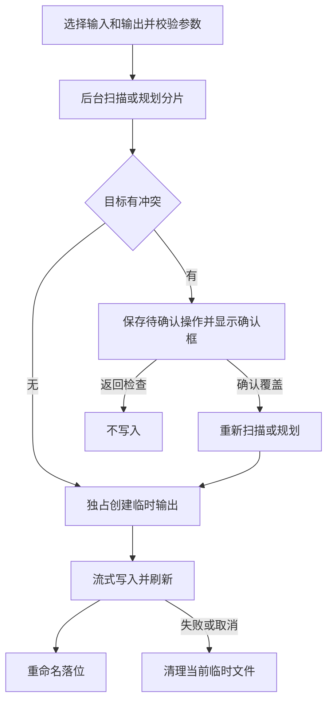

# Markdown 合并、拆分与原文件保护

「MD 整理」是独立工具，只合并和拆分已有 Markdown，不是把其他格式转换成 Markdown；后者见[转 Markdown](markdown-conversion.md)。输入只读，输出写到用户选择的位置。规格范围见 [Markdown 整理规格](../../openspec/specs/markdown-organization/spec.md)，通用任务安全见[文件任务安全](../concepts/file-task-safety.md)。

图：从输入预检到覆盖确认、临时输出和提交的主要路径；拆分逐片提交，不是整批事务。

## 扫描与合并

GUI 的 `md_merge_run` 调用 `scan_markdown` 后再调用 `merge_markdown_with_events`；无匹配文件时报告且不生成输出。非递归只取直属文件，递归遍历子目录，`.md` 扩展名不区分大小写。不排除 Git 树或隐藏文件。根目录及其访问路径的祖先若经过符号链接、junction 或其他 reparse point 则拒绝，遍历时也不跟随链接；扫描错误直接返回，不悄悄跳过。输出路径即使在扫描树内也会按路径归一化排除。其他路径若与输出是同一文件实体，例如硬链接，则在确认和写入前拒绝；核心写入入口也再检查一次。[扫描实现](../../crates/md-tools/src/md_tools/scan.rs)

排序先按创建时间从早到晚，取不到则退回修改时间，再取不到用 epoch；时间相同时按统一 `/` 的相对路径自然排序。数字段按数值比较，故 `2.md` 在 `10.md` 前；非数字段按 Unicode 码点顺序，数值相等的不同写法再以归一化路径文本决胜。改变比较器时应保留数字段、段边界和决胜规则，而不是简单字典序。

合并逐文件逐行写入：每个输入前添加带扩展名的 `# 文件名.md` 和空行，文件之间补足换行；每个文件开头的 UTF-8 BOM 被剥除一次，中间 BOM 保留。`HeadingShift` 对 ATX 标题下移一级、六级封顶；Setext 的 `=` 和 `-` 分别转换为二级和三级 ATX，并删除下划线。它暂存一行来判断 Setext，同时避免把列表、引用、分隔线或缩进代码当作标题文本。[标题状态机](../../crates/md-tools/src/md_tools/heading.rs)

fence 可用反引号或波浪线，至少三个字符，行首至多三个空格；闭合须与开始字符相同、长度不短于开始且尾部只有空白。fence 内原样输出，四空格缩进的行不被当作标题或 fence。合并是流式而非加载整个目录，但超长单行仍须缓存在内存中。[合并实现](../../crates/md-tools/src/md_tools/merge.rs)

## 拆分不变量

GUI 接受 `.md` 输入、输出目录和正的大小，KB 与 MB 分别按 1024 和 1024² 字节换算，必须得到整数个字节。`plan_splits` 先计算所有结束偏移，后续 `run_split_with_events` 按偏移分块复制；空文件得到空计划，不生成分片。每片字节数不超过限制，可以跨越章节、段落乃至代码块，不添加标题或其他文字。对合法 UTF-8，边界向前回退到字符边界，按编号直接二进制拼接必须精确恢复原文，包括 BOM；限制容不下单字符时规划报错，尚未创建输出。非法 UTF-8 不保证分片有效 UTF-8：极端连续字节序列有逐字节回退，但仍保留字节内容。[拆分实现](../../crates/md-tools/src/md_tools/split.rs)

输出如 `document_001.md`，编号至少三位，按实际总片数统一扩宽；超过 999 片时仍可按文件名排序。规划与写入分两遍，调用方应避免其间修改输入，否则计划不再代表同一份内容。

## 确认、提交与取消

GUI 启动时保存 `MdPending::Merge` 或 `MdPending::Split`，后台先扫描或规划，再预检所有目标。冲突通过 `MD_CONFLICT` 转为 `MdNeedsConfirm`；明确确认后消费待确认操作，以 `overwrite=true` 和新的 `Control` 重跑扫描或规划，而不是沿用旧计划。未确认时核心入口也拒绝冲突。目标占用使用 `symlink_metadata`，悬空链接等目录项也算冲突。这是 MD 整理的**显式覆盖确认**，不能套用其他工具的不覆盖策略。[GUI 接线](../../crates/gui/src/gui/md_git.rs)、[输出辅助函数](../../crates/md-tools/src/md_tools/output.rs)

输出目录内用 `create_new` 独占创建带进程号、时间和序号的非 `.md` 临时文件，写完刷新后 `rename` 到目标；不直接截断已有文件。合并失败或取消时尝试清理本任务临时文件，清理失败会记录警告。拆分每片单独临时写入并落位，后续失败或取消时只清理当前未完成的临时文件，**已提交的前面分片不会回滚**；因此失败不留半成品指单个未完成输出，而非整批全有或全无。重命名失败也可能由平台占用或权限导致，不能假设确认覆盖必定成功。

扫描逐项、拆分规划每 512 个边界、分片复制每块检查 `Control`；合并每 512 行检查，超长行读取也每 256 KiB 检查，合并正式提交前再检查。后台发送 `FileStarted` 和 `FileCompleted`；GUI 只用完成事件推进完成计数，避免刚开始就显示完成。取消和失败分别记录日志，清理失败也有警告。[GUI 进度与运行段](../../crates/gui/src/gui/md_git.rs)、[核心合并](../../crates/md-tools/src/md_tools/merge.rs)

## 修改时检查的边界

- [拆分断言](../../tests/md_tools.rs)逐片检查大小、UTF-8 有效性，并将输出拼接后与源字节比较；[具体用例](../../tests/md_tools/split_parts.rs)覆盖中文和 Emoji、1 字节 ASCII、限制不足时无新增条目，以及 1200 片统一四位编号。
- 同一组测试断言未确认冲突时旧分片不变且第二片不存在，确认后才覆盖；另有源文件前后字节相等的断言。修改输出逻辑时还应检查硬链接、取消和清理失败边界。
- 扫描、标题和 GUI 确认的回归入口分别见 [扫描测试](../../tests/md_tools/scan.rs)、[合并测试](../../tests/md_tools/merge.rs)和 [GUI 测试](../../crates/gui/src/gui/tests_md_git.rs)。这些是源码中的断言与测试入口，并不表示本次文档工作实际执行了测试；运行环境和验证策略见[验证](../testing/verification.md)。
