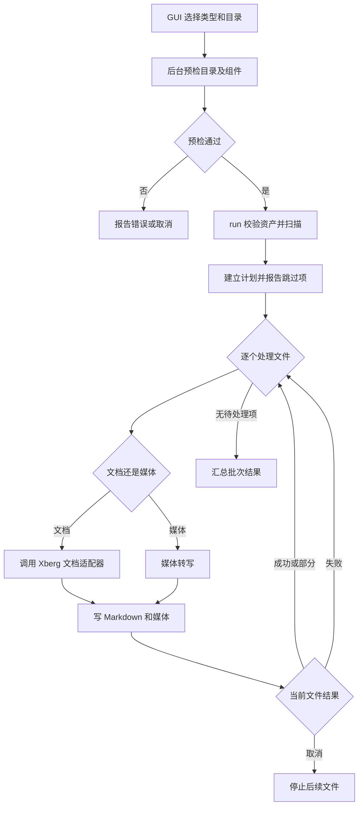

# Markdown 转换、合并与拆分

此页包含三条不同的文件工作流：批量转换器把受支持的文档或媒体变成 Markdown；MD 合并和 MD 拆分则是独立的整理工具，不依赖转换引擎。GUI 负责参数、就绪提示、后台任务与进度事件，核心逻辑在 `crates/markdown` 或 `crates/md-tools`，输入通常只读，输出通过单独的目标路径提交。

## 转换：预检、扫描、逐文件转换

GUI 的 `wire_markdown_converter` 接入转换页操作。用户选择格式组（PDF、Office、图片、媒体、其他）、输入和输出目录、是否平铺以及单文件超时。超时必须为正整数秒且可由系统时间表示。点击开始时先检查转换页状态与就绪标志，再由后台线程做预检：输入输出都必须可访问且为目录、不能相同，所选组所需运行资产必须就绪。预检失败或取消不会启动批次；准备与运行各自有 GUI 状态和事件。

运行入口 `markdown::run` 再次校验选项与组级资产，获取运行目录，查询支持格式并扫描输入，形成计划。已有结果、重复目标和扫描失败会计入批次总数；扫描失败作为单文件失败报告，不妨碍其余文件继续。每个待处理文件有独立超时预算，文档交由 `markdown_document::convert_cancelable`，媒体交由媒体转换路径；逐文件成功写入后才更新统计，带引擎警告的结果算“部分成功”，普通错误记为失败。

图：GUI 预检后由批次运行器扫描并逐文件分派，写入结果后继续、报告失败或响应取消。

### 输出与媒体安全

文档适配器调用已初始化的共享 Xberg 引擎，不自行启动 HTTP 服务或 Python；最终 Markdown、规范化和页数自动分流由引擎负责。适配器解析响应并按接口约定改写图片引用、登记媒体字节，同时传递警告。输出写入器不覆盖既有 Markdown 结果：检查目标及目录链，拒绝符号链接/junction 等不安全路径；先写媒体文件，再用临时 Markdown 文件提交正文。Markdown 文件出现代表本次媒体已完整，若中途失败或取消，会删除本次创建的媒体与空目录，不触碰已有文件。文件级失败不会抹除其他已完成文件；批次取消停止当前文件并且不再开始后续文件。超时和取消在转换及写盘边界检查。

就绪检查按场景区分：仅媒体组需要共享引擎，文档组需要文档资产；所选组检查不要求不相关组件就绪。媒体缺少转写资产在具体转写边界明确报错，不以联网下载掩盖缺失。Windows 运行还要求 Windows 11 x64 和 AVX2；其他平台拒绝转换。

## 合并：独立的流式文本整理

合并入口位于 GUI 的 MD 工具页，后台扫描目录中的 `.md` 输入（可递归），排除输出自身，并按扫描器定义的自然/创建时间顺序形成条目。核心 `merge_markdown_with_events` 逐文件逐行流式处理，不把整批内容载入内存：为每个文件写入 `# 文件名` 标题，调整正文标题层级，并保护代码块中的标题；文件边界补充必要换行。首行 UTF-8 BOM 在合并时剥除，避免标题识别受影响。

输出与任何输入是同一文件实体（包括别名/硬链接）时，在写入前拒绝；输出已存在时先由 GUI 请求覆盖确认，确认后重新扫描并运行。核心先写任务独有临时文件，所有输入成功且最终取消检查通过后再 rename 提交；失败或取消清理临时文件，不留下半成品，也不改动输入。合并在文件边界及行循环中检查共享 `Control`，长行读取亦周期性检查，因此暂停/取消无需等整个文件结束。

## 拆分：字节级无损分片

拆分接受单个 `.md` 文件和字节上限，不解析或重写 Markdown。`plan_splits` 第一遍只规划递增的结束偏移：每片不超过上限，并在合法 UTF-8 内容中回退到字符边界；若上限小于一个字符所需字节数则报错，不产生输出。非法 UTF-8 序列仍按字节推进，确保字节不丢失。空文件返回空计划，GUI 显示无可拆分内容。

第二遍按计划顺序分块复制到编号分片。每片先写独立临时文件再 rename；失败或取消清理当前未提交临时文件。未确认覆盖时，若任一目标分片已存在则拒绝；GUI 允许用户确认后重跑。拆分不改变源文件，按编号二进制拼接生成的分片可还原原始字节，因此也不会像合并那样增加标题或规范化换行。取消检查覆盖规划阶段及分块复制阶段。

## 边界与验证

三种任务都由 GUI 后台线程执行，进度和完成结果经事件回送；MD 合并/拆分共享 `MdProgress` 口径与 `Control` 任务控制，但它们与转换批次互不调用。扩展时应分别维护转换的资产/格式边界、合并的文本规则、拆分的偏移约束，不要把合并改写规则套用到拆分上。

聚焦测试包括 `tests/markdown_convert_gate.rs` 对转换门禁/预检行为的回归，`tests/split.rs` 对拆分计划及无损行为的验证；MD 核心模块另有针对排序、合并保护和输出冲突的单元测试。修改取消或输出提交语义时，应覆盖取消时不留下半成品、冲突未确认不覆盖，以及拆分拼接逐字节一致等性质。

## 相关页面

- [文件任务](../concepts/file-tasks.md)：共享任务状态和取消控制。
- [应用架构](../architecture/application.md)：GUI 与后台任务边界。
- [Xberg 与 OCR](../integrations/xberg-and-ocr.md)：文档转换引擎边界。
