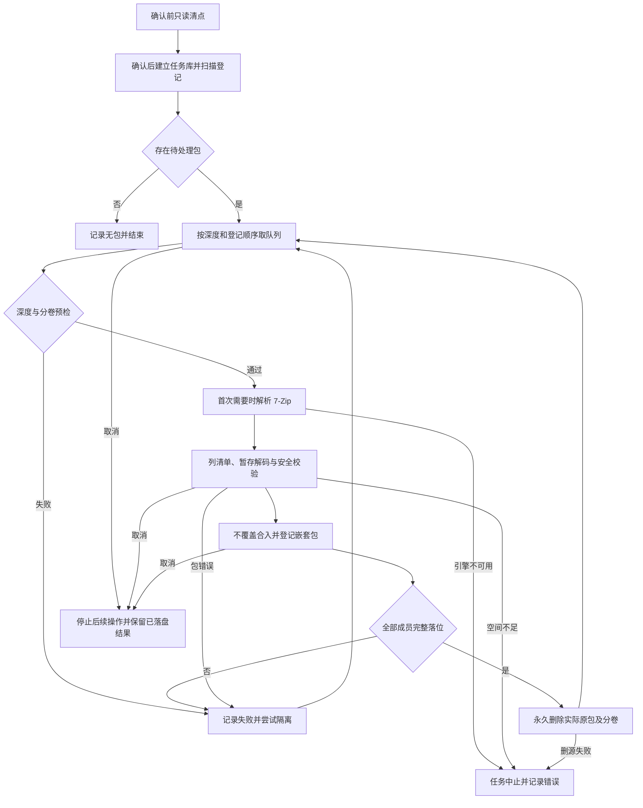

# 递归解压：引擎、队列与失败隔离

递归解压是**确认后连续执行的一段式任务**，不是[目录整理](directory-organization.md)的分析、计划审核再执行。确认框说明就地输出、冲突改名，以及完整成功后原包和分卷**永久删除、不可恢复**；失败、未完全解开或取消时保留源项。确认前后台只读清点，清点失败直接报错，不猜测数量。

图：队列串行处理成功、普通失败和取消；任务级错误不被当作一批坏包隔离。

## 从清点到队列

GUI 的 `start_extract` 校验解压配置，建立独立 `Control` 并在后台调用 `extract_run`。引擎先做根目录及受保护路径预检，再创建状态为 `executing` 的任务库，调用 `scan` 登记文件和待处理归档。没有待处理包时记录提示，不解析引擎；正常结束保存摘要并标记 `finished`，错误则记录任务失败。确认框清点和正式扫描共用范围过滤：递归开关、隐藏和系统项、排除规则、Git 整树、状态及程序目录、受保护子树，以及名为「解压失败」的目录都影响范围。有效所有权标记的解压工作区也会剪枝；普通同名目录不因此被排除。

分卷按同目录命名族归组，而不是每个卷都算一包；缺入口但可归组的残缺卷集也计入清点并登记，歧义组不会被当成多个独立包。队列按 `depth,id` 取 `pending`，标记 `running`，逐包处理；最大嵌套层数及分卷预检先于引擎解析。落盘的新嵌套包按目录归组、以更深一层登记，队列继续消费；即使合入中途出现普通错误，已经发布的嵌套包仍可登记。取消或空间类任务中止则不启动后续嵌套登记。不开启递归时，子目录中的新嵌套包不继续处理；隔离容器同名目录下的包也不递归。

## 引擎、暂存与安全落位

第一个通过预检、真正需要解码的包才解析 `SevenZip`，随后同任务复用。生产解析依次检查程序旁 `resources/7zip`、用户数据目录中已释放的内嵌副本，再尝试释放内嵌副本；候选的必需文件须通过适用清单和 SHA-256 校验，不覆盖占用文件，必要时使用独立释放目录。所有候选不可用时明确中止任务，不把正常包逐个隔离。`extract_run_at` 的显式路径是测试或开发注入，不是生产用户的引擎路径配置，也不从系统 PATH 推断。构建及引擎交付见[构建与交付](../operations/build-and-delivery.md)。

7-Zip 先列成员和大小，检查展开空间与限制，在工具拥有的工作区解码并验证暂存结果，再把成员合入包所在目录。复合压缩流先在暂存内展开至 tar，仍作为一层处理。路径须安全相对、父链不得穿透链接，暂存中的链接或非普通文件不能合入；排除规则和 Git 边界同样作用于输出。具体安全边界参见[文件任务安全](../concepts/file-task-safety.md)。

既有文件、目录和链接不被覆盖：文件冲突只给新成员分配带序号的名字，保留扩展名及复合扩展名；同名普通目录可合并，目录名被文件或链接占用时整棵新目录映射到新名字。最终发布使用不覆盖的重命名，竞争产生的新冲突也改名处理。空目录在文件合入后创建。成员被过滤、无法落位或 Windows 隐藏/系统属性无法按配置清理时，包不算完整成功；已落盘内容不回滚。

分卷文件名只用于发现候选：成功删源及展开比例使用实际确认的卷集，而不是删除所有同主干文件。整包解码、校验及所有成员和空目录完整落位后，才逐卷永久删除源项，不受整理工具的删除方式影响。删除前逐卷检查取消；删源失败是任务级中止，不隔离该包、不继续后续包，已经删除的卷不回滚，当前卷也可能已删除。因而取消或删源失败发生在逐卷删除期间时，不能承诺整个卷集仍完整。

## 失败、隔离与取消

损坏、加密、不支持、达到嵌套上限等普通包错误，以及成员被跳过导致的未完全解开，计入失败并尝试将原包和在场兄弟卷移入所选根目录下的「解压失败」。隔离不是删除：整组先规划不冲突名字，保留各卷后缀，再逐卷不覆盖移动；隔离卷集的发现比永久删源的授权宽，不能混为一谈。扫描和新嵌套包处理均排除该容器，避免反复处理失败包。

容器被普通文件、链接或 Git 项目占用时不穿透或覆盖；无法分配名称或某卷移动失败时，也不虚报整组隔离。已经移动的卷留在容器，未移动的源项留在原处，日志记录实际位置，其他包通常继续。摘要的隔离数是实际移动的原包或分卷**文件数**，不是失败包数。空间不足属于任务级中止，保留源包，不把后续正常包批量隔离。

取消在检查点生效：当前归档错误状态先落库，但取消不计普通包失败、不触发隔离，也不回滚已发布内容；操作中已开始的逐卷删除或隔离可能只完成一部分。子进程无 shell 启动并有界读取输出；流式处理期间持续检查取消，暂停则推迟到当前包结束以便排空管道。连续无输出默认十分钟超时；取消、超时、管道或回调错误会终止并回收子进程，Windows 使用 Job 管理进程树，管道收尾有期限。非零退出码包括警告都不视为完整成功。

## GUI 失败列表与任务库

启动新解压会清空上一次列表和分页游标。工作线程在引擎建库前快照已有 `tasks` 目录，watcher 在后台发现新任务目录，使运行中也能查询失败；结果通过独立通道回到界面，代际号防止过期发现和分页结果覆盖新任务。任务结束或取消后列表保留，直到下次启动解压。

分页 worker 打开任务库的 `events`：以「解压/失败」「解压/未完全解开」及单独标识的「删除/失败」为列表项，不把删源失败冒充坏包。串行处理产生的后续隔离移动和隔离失败事件，按事件 ID 区间归到对应失败项；多个卷的位置合并显示，没有记录的位置不伪称已隔离。每页最多 100 项，游标按事件 ID 前进；详细原因和部分隔离位置以任务日志为准。

## 重点验证

- [引擎与清点测试](../../crates/recursive-extract/src/engine.rs)覆盖分卷歧义归组、受保护范围和容器占用时摘要不虚报。
- [归档集成测试](../../tests/archive.rs)、[引擎契约测试](../../tests/contract_engine.rs)与[扫描深度测试](../../tests/scan_depth.rs)覆盖真实归档处理、契约和扫描范围；[GUI 失败列表测试](../../crates/gui/src/gui/tests_extract_fail.rs)覆盖任务库与失败列表联动。
- [进程实现](../../crates/file-core/src/process/stream.rs)及其测试关注取消、超时和子进程回收；更多验证方式见[验证](../testing/verification.md)。
