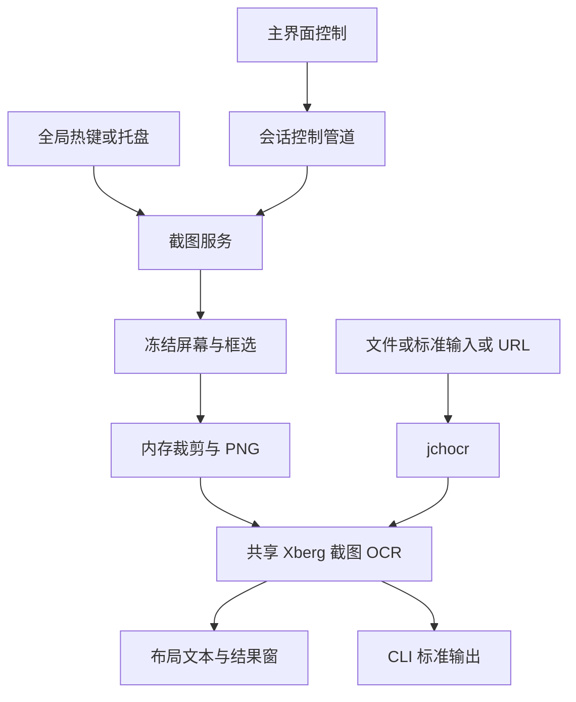

截图 OCR 是当前用户会话中的常驻交互服务；`jchocr.exe` 是供脚本和其他程序调用的独立控制台程序，不是新的 GUI 工具。两者均使用唯一生效的共享 Xberg 目录和 `ocr_snapshot` 截图识别通道，而不是分别维护模型或推理进程。共享代理的生命周期与目录选择详见[共享 Xberg](../integrations/shared-xberg.md)。



图：两种入口在共享截图识别处汇合；控制管道本身不传截图或正文。

## 截图后台：从热键到结果窗

服务不是 Windows 系统服务，而是独立于主窗口的当前登录会话进程。默认热键为 `Ctrl+Alt+O`；托盘还提供截图、设置、自启、打开主界面及退出。关闭主窗口不关闭托盘、注销热键或取消截图；重复启动通过会话级 `Local` 互斥体发现已有服务，并向其转发打开设置请求。不同登录会话互不阻塞。启动时启用 PerMonitorV2，创建托盘、控制管道和独立推理线程，然后异步加载或复用模型。GUI 打开页面时只离线检查资产，不因切换页面联网。参见[服务启动](../../optional/snap-ocr-worker/src/service.rs)和[GUI 接线](../../crates/gui/src/gui/snap_ocr.rs)。

热键录制要求修饰键和可识别的主键；GUI 与后台须保持 Shift 数字和标点的反向映射一致，例如 `Shift+7` 的 `&` 归一化为 `7`。更换时先注册新组合，冲突保留旧热键。登录自启默认关闭、由用户显式设置，管理当前用户的本功能启动项；服务只刷新已启用但路径过期的启动项，不把损坏值当作用户授权。登录自启取得单实例后才解除上次退出的后台抑制。

按 [O-17～O-22 规格](../../openspec/specs/screenshot-ocr/spec.md)，截图先隐藏应用相关窗口，使用 `BitBlt + CAPTUREBLT` 捕获鼠标所在显示器的物理像素，再在冻结画面上框选；不支持跨屏，Esc、右键或过小选区取消。同一时刻仅一个截图任务，识别期间再次触发不排队。新任务开始时隐藏旧结果；取消、无文字或失败恢复旧结果，成功才替换。结果窗展示只读、保留空格和换行的等宽文本，支持选择和复制；复制全部后关闭窗口，Windows 剪贴板不自动清空。

后台将裁剪图编码为内存 PNG 后发送共享客户端。加载检查字体与截图资产并用 1×1 白图预热；模型状态区分未初始化、加载中、就绪和错误。取消后若共享模型仍就绪可直接复用；超时只结束本次请求并将截图模型降级，保留重试，不终止共享引擎或其他功能。普通识别失败与进程退出、通信失败、资产失效分别处理。详见[推理线程](../../optional/snap-ocr-worker/src/service/inference.rs)。

控制管道和推理数据通道不可混为一谈：前者是当前用户会话命名管道，单连接一条换行结束的 JSON 请求和响应，只传状态及控制，不传图像或文字。管道仅允许对象所有者与 SYSTEM，拒绝远程客户端；服务端限制请求 4096 字节、连接处理期限 15 秒，分派等待服务响应最多 10 秒。GUI 每次新建连接，忙时最多等待约 2 秒，响应读取默认 10 秒并取消未决 I/O，避免监督线程永久卡住。`diagnostic_id` 用于关联低敏诊断。命令包括 `ping`、`get-state`、`capture`、`retry-load`、`save-settings`、`cancel` 和 `shutdown`；具体处理以服务协议为准。见[协议实现](../../optional/snap-ocr-worker/src/service/protocol.rs)。

托盘退出与关闭窗口不同：按 O-16/XB-23 确认并安全结束在途任务，取消识别后等待不可中断的推理调用返回，再释放热键、托盘及共享后台资源；超过 10 秒才提供显式强制退出，不自动强杀仍有其他任务的共享引擎。设置和自启的持久化、诊断位置见[状态与诊断](../operations/state-and-diagnostics.md)。

## jchocr：单张图片的命令行合同

```text
jchocr <图片绝对路径或HTTP(S) URL> [--json]
jchocr --stdin [--json]
jchocr --base64 <Base64值或-> [--json]
jchocr --help | help
jchocr --version
```

每次只能选一种输入，本地路径必须绝对；`--stdin` 读取原始图片字节，`--base64 -` 从标准输入读取标准 Base64，忽略 ASCII 空白，不接受 data URL。帮助和版本无需引擎，不能与图片输入组合；重复或未知选项、空输入和无效 Base64 均报错。支持哪些图片格式最终取决于引擎。解析实现见[cli.rs](../../crates/jchocr/src/jchocr/cli.rs)。

本地输入先读取并检查非空，再选择和验证生效 Xberg；URL 则先检查 Xberg，避免资产不可用时仍下载。显式调用可恢复托盘停止后的共享后台，但不启动托盘或 GUI，也不擅自更改已保存的选择。图片以 Base64 传入 `ocr_snapshot`，请求期限为 600 秒；不需要调用方管理代理或请求 ID。缺失截图资产应按提示修复安装包或重新解包，而非下载另一套模型。参见[CLI 共享客户端](../../crates/jchocr/src/jchocr/xberg.rs)和[构建与交付](../operations/build-and-delivery.md)。

默认成功时 stdout 只含 UTF-8 原文，不额外添加换行；`--json` 输出 `{"ok":true,"text":"..."}` 和换行。无文字是成功的空文本。失败写 stderr，JSON 模式为 `{"ok":false,"error_kind":"...","error":"..."}`，即使其他参数无效也识别 `--json`。退出码：`0` 成功，`2` 参数或输入错误，`3` Xberg 或截图资产不可用，`1` 网络、推理或运行错误；stdout 写入失败也是运行错误。错误类型包括 `usage`、`input`、`xberg`、`network`、`inference`、`runtime`。

显式 URL 仅允许 HTTP(S)，最多跟随两次重定向，每跳重新按系统代理选路；代理连接阶段失败可直连重试一次，TLS 或响应阶段错误不因此回退，TLS 校验保持开启。连接、响应和正文读取各设 30 秒超时。下载预算由共享消息上限扣除 256 KiB 元数据并考虑 Base64 的 4:3 扩张计算；既检查 `Content-Length`，也限制流式读取，超限报网络错误而不将截断图片送去识别。详见[下载实现](../../crates/jchocr/src/jchocr/download.rs)。

## 隐私与验证边界

O-29/O-30 要求截图、裁剪、进程间图像、识别正文和临时结果只驻内存，不自动上传、保存历史或写入日志；主动复制的去敏诊断不含正文、截图和用户路径。CLI 的显式 URL 下载是获取调用者指定图片的例外，不是云 OCR 或模型下载；日志不得包含图片、Base64、正文、完整 URL 或用户路径。剪贴板历史、操作系统分页和原生库释放后的安全擦除不在应用保证范围内。

`optional/snap-ocr-core` 是无人依赖的冻结纯逻辑规格参照物，用于构造输入的瓦片、几何和布局验证，**不是生产识别链路**；当前生产推理由共享 Xberg 承接，不能把该 crate 单测或旧对照报告当真实 OCR 验收。见[参照物说明](../../optional/snap-ocr-core/AGENTS.md)。

[CLI 进程合同测试](../../crates/jchocr/tests/jchocr.rs)使用 Windows `test-hooks` 和隔离状态，不依赖真实模型，覆盖参数、帮助、错误通道和资产发现等；Slint 后端测试验证组件和事件接线，不能证明真实桌面热键、托盘、捕获或识别。真实桌面验收还需实际热键/托盘、取消与旧结果恢复，以及多显示器、负坐标和 100%～200% DPI；真实模型质量、安装包与便携包交付也需分别验证。规格的验收目标不是已通过的结果，相关测试层次见[验证](../testing/verification.md)。
